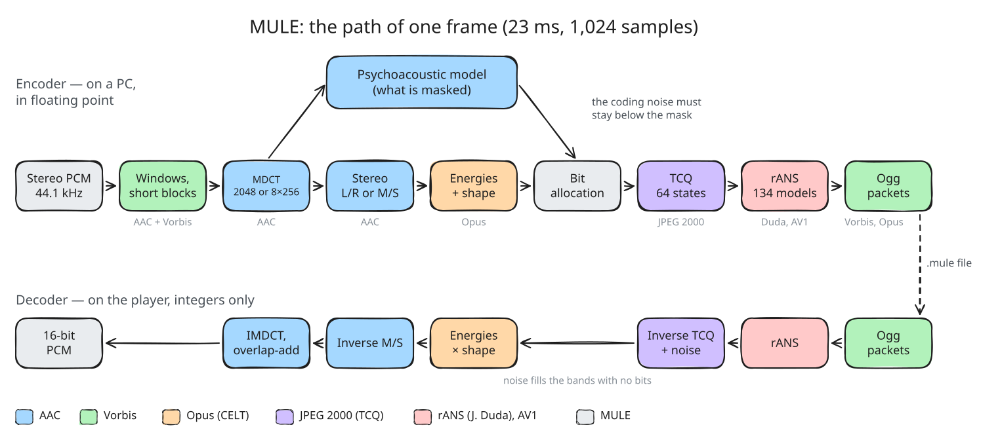

# MULE

*A lossy music codec that nobody asked for.*

A mule is what you get when you cross a horse and a donkey. It is sturdy, it carries its load,
it is famously stubborn, and it has no offspring. MULE is the same thing for audio: a cross
between **Opus**, **Vorbis** and **AAC**, built to run on one tiny music player, the Snowsky
Echo Mini (a Cortex-M3 without a floating-point unit). It carries the music, it refuses to go
at low bitrates, and it will not start a dynasty.

This is an **experimental, learning project**. It does not try to replace anything, and it
does not. If you want a good lossy codec, **use Opus**. If you want to see what happens when some idiot
builds one from scratch, measures everything, listens blind, and writes down every idea that did
not work, read on.

## What it is made of



| Body part | Taken from | Notes |
|---|---|---|
| MDCT 2048 / 8 × 256, block switching, grouping of short windows | AAC | |
| Window shape (power-complementary "Vorbis" slopes) | Vorbis | |
| Ogg container, gapless granules, comment header | Vorbis / Opus | `MULETags` is `OpusTags` with another name |
| Band energies coded apart from a normalized shape, noise filling | Opus (CELT) | the energy stays right, even when the shape is coarse |
| Pre-echo control in the psychoacoustic model | AAC | the only pre-echo idea that worked |
| Shape quantizer: trellis-coded quantization (TCQ), 64 states, one trellis running across the bands | JPEG 2000 part 2, VVC | the one original-ish part |
| Entropy coding: rANS with adaptive multi-symbol CDFs | rANS (J. Duda), CDF adaptation as in AV1 | 134 adaptive models, trained initial tables |
| Decoder in integers only, bit-exact everywhere | necessity | the target has no FPU |

Why hasn’t anyone tried this combination before? Back when Opus was being developed, most of these techniques were tied up in software patents. For some of them, that’s no longer the case, and I couldn’t care less.

How it all works, step by step, for readers with no signal-processing background: [*Anatomie
d'un codec audio moderne, en le construisant (mal)*](https://berettavexee.github.io/2026/11/19/mule-anatomie-codec-audio/)
(blog post, in French).

## Results

Measured on 30 tracks drawn at random from my music library and never used for tuning, at equal
real bitrate (curves interpolated). ODG is PEAQ's score: 0 = no difference *(audio transparency)*, −1 = audible but not
annoying *(good)*, −4 = very annoying (shit). ViSQOL (Virtual Speech Quality Objective Listener) scores range from 1 (the worst) to 5 (the best).

| | ODG @128 kb/s | ODG @160 kb/s | ODG (advanced) @128 / @160 | ViSQOL @128 |
|---|---|---|---|---|
| AAC (FDK-AAC) | −0.54 | −0.21 | −0.57 / −0.27 | 4.30 |
| Vorbis (libvorbis) | −0.45 | −0.16 | −0.63 / −0.34 | 4.47 |
| AAC (Apple, qaac TVBR) | −0.31 | −0.02 | −0.46 / −0.22 | 4.49 |
| Opus (libopus) | **−0.12** | **0.00** | −0.45 / −0.24 | 4.54 |
| MULE (format v3) | −0.17 | −0.01 | **−0.36 / −0.14** | **4.61** |

In plain words:
- **at 128 kb/s and above**, MULE beats Vorbis and FDK-AAC everywhere, loses to Opus on PEAQ's
  basic score, and wins on the advanced score and ViSQOL. Apple's AAC encoder is far ahead of
  FDK on the same format (+0.23 ODG at 128 kb/s), behind MULE at 128 kb/s and level with it on
  PEAQ's basic score at 160 kb/s: in a codec, the encoder is what matters. In blind ABX tests on the six excerpts
  where PEAQ saw the biggest gap, I could tell MULE at 128 kb/s (format v2) neither from the
  original nor from Opus;
- **below 96 kb/s**, use Opus: it has a decade of low-rate tools that MULE never got;
- **on the device**, the decoder runs core B at about **59 MHz**, in 30 KiB of code and tables
  and 91 KiB of RAM, with the same output, bit for bit, on the PC, the firmware's emulator and
  the Cortex-M3 (measured with format v2; v3 needs 8 % fewer instructions, not yet ported).

So, officially: a codec that is worse than Opus on almost every count, and sometimes as good.
This is a surprise; outperforming Vorbis was by no means a sure thing. Coming close to Opus
was unexpected.

At 128 kb/s, telling two modern codecs apart by ear is close to impossible, so almost every
decision was taken by automated measures instead (PEAQ basic and advanced, ViSQOL, an internal
noise-to-mask ratio), and an idea was kept only if they agreed on an independent test set.
Those machines have blind spots, and this project walked into most of them: see
[`docs/LESSONS.md`](docs/LESSONS.md).

## What was learned

The details, the numbers and the dead ends are in [`docs/LESSONS.md`](docs/LESSONS.md). In short:
- **TCQ is worth it**: a trellis quantizer instead of plain rounding, +0.06 ODG at 128 kb/s, for
  one more table in the decoder;
- **a bigger trellis, running across the bands** (format v3): 64 states and one Viterbi search
  per frame, +0.036 ODG, the biggest encoder gain after TCQ itself;
- **one psychoacoustic fix clearly paid**: masks computed line by line in the low bands, up to
  +0.2 ODG on an orchestra;
- **against pre-echo, only AAC's mask bound worked**; temporal noise shaping, MPEG's model 2,
  more short blocks, a Haar transform inside the bands: all measured, all abandoned;
- **the compression comes from the modelling, not from the coder**: rANS codes within 0.01 % of
  the ideal cost, the contexts are worth 13 %;
- **fuzzing pays**: it found a decoder bug within minutes;
- **the last gap to Opus is diffuse**, a few hundredths of ODG on which the metrics disagree and
  that my ears could not hear.

## Repository

| Path | Content |
|---|---|
| `spec/FORMAT.md` | the stream format, normative (in French) |
| `core/` | the codec in C: `dec.c` (decoder, integers only, the reference), `enc.c` and its modules `enc_dsp.c`, `enc_psy.c`, `enc_tcq.c`, `enc_ogg.c` (encoder), `model.c` / `models.c` (adaptive models), `rans.c` (rANS coder) |
| `tools/` | `mule-enc`, `mule-dec`, `mule-gain`, the generators of the tables in `core/`, and the fuzzing harness (`tools/fuzz/`) |
| `py/mule/` | Python bindings (cffi), settings, Ogg comment handling, ReplayGain (BS.1770-4) |
| `eval/` | the evaluation (`eval/README.md`): corpus building, reference codecs, metrics (internal NMR, PEAQ, ViSQOL), equal-rate comparisons; logs and results in `eval/results/`, past one-off scripts in `eval/archive/` |
| `tests/` | unit tests, and frozen decoder test vectors |
| `bench/qemu/` | Cortex-M3 benchmark under QEMU (instruction counts, bit-exactness) |
| `docs/` | `LESSONS.md` (everything measured), `ARTICLE.md` (how MULE works, two pages), `PORT.md` (the port to the player), `V3-IDEAS.md` and `V4-IDEAS.md` (the ideas studied for each format), `VARIANTS-BC.md`, `TODO.md`, `blog/` (the blog posts, their figures and tools), `history/` |

Most of the documentation and logs are in French, my language.

## Building and using

Requirements: a C99 compiler, Python 3 with numpy, scipy, soundfile, soxr and cffi
(`requirements.txt`). For the evaluation: `opusenc`, `oggenc`, `ffmpeg`, and optionally
[GstPEAQ](https://github.com/HSU-ANT/gstpeaq) and [ViSQOL](https://github.com/google/visqol).

```sh
python3 -m venv --system-site-packages .venv && .venv/bin/pip install -r requirements.txt
make                                    # build/libmule.so, build/mule-dec
make test

tools/mule-enc in.flac out.mule         # 128 kb/s by default (my library average: VBR)
tools/mule-enc --bitrate 160 --title "..." --picture cover.jpg in.wav out.mule
tools/mule-gain -a album/*.mule         # ReplayGain 2.0, track and album
tools/mule-dec out.mule out.wav         # 16-bit WAV, the reference decoder
```

`mule-enc` takes `opusenc`'s options (`--bitrate`, `--title`, `--artist`, `--comment tag=val`,
`--picture`, `--discard-comments`...), any input libsndfile reads (or `-` for stdin), any sample
rate (resampled to 44.1 kHz, the only one the format knows), mono or more than two channels
(made stereo), and copies the tags and pictures of a FLAC input.

The evaluation corpus is not included (it comes from the EBU SQAM disc and a private music
library); `eval/corpus.py` shows how it was cut (the library's root in `MULE_LIBRARY`).

## Limits

44.1 kHz stereo only. Tuned for 128 to 160 kb/s; poor below 96 kb/s. One encoder, one decoder,
no ecosystem: nothing else in the world plays a `.mule` file, apart from one firmware on one
player.

## Credits

MULE is built from other people's ideas:
- **Jarek Duda**, for asymmetric numeral systems, the entropy coder:
  [the paper](https://arxiv.org/abs/1311.2540), [his page](http://th.if.uj.edu.pl/~dudaj/),
  [GitHub](https://github.com/JarekDuda);
- **Xiph.Org**: [Opus](https://opus-codec.org/) ([RFC 6716](https://www.rfc-editor.org/rfc/rfc6716)),
  whose CELT layer gave MULE its bands and its energy/shape split;
  [Vorbis](https://xiph.org/vorbis/), for the window; [Ogg](https://xiph.org/ogg/), for the container;
- **MPEG AAC**, for block switching, short-window grouping and pre-echo control;
  [FDK-AAC](https://github.com/mstorsjo/fdk-aac) served as a reference in the measurements;
- **M. W. Marcellin and T. R. Fischer**, for trellis-coded quantization
  ([1990](https://doi.org/10.1109/26.46532)), later part of [JPEG 2000](https://jpeg.org/jpeg2000/);
- **[AV1](https://aomedia.org/specifications/av1/)**, for the adaptive CDF update;
- the measuring tools: [GstPEAQ](https://github.com/HSU-ANT/gstpeaq), [qaac](https://github.com/nu774/qaac) (to run Apple's AAC encoder),
  [ViSQOL](https://github.com/google/visqol), [QEMU](https://www.qemu.org/), and the EBU SQAM disc;

## License

MIT (`LICENSE`).
