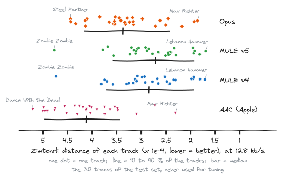
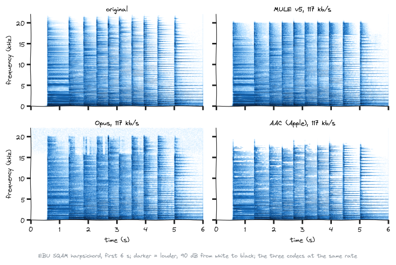

# MULE

*A lossy music codec that nobody asked for.*

A mule is what you get when you cross a horse and a donkey. It is sturdy, it carries its load,
it is famously stubborn, and it has no offspring. MULE is the same thing for audio: a cross
between **Opus**, **Vorbis** and **AAC**, built to run on one tiny music player, the Snowsky
Echo Mini (a dual Cortex-M3 SoC without a floating-point unit). It carries the music, it refuses to go
at low bitrates, and it will not start a dynasty.

This is an **experimental, learning project**. It does not try to replace anything, and it
does not. If you want a good lossy codec, **use Opus**. If you want to see what happens when some idiot
builds one from scratch, measures everything, listens blind, and writes down every idea that did
not work, read on.

## What it is made of


| Body part | Taken from | Notes |
|---|---|---|
| MDCT 2048 / 8 × 256, block switching, grouping of short windows | AAC | |
| Window shape (power-complementary "Vorbis" slopes) | Vorbis | |
| Ogg container, gapless granules, comment header | Vorbis / Opus | `MULETags` is `OpusTags` with another name |
| Band energies coded apart from a normalized shape, noise filling | Opus (CELT) | the energy stays right, even when the shape is coarse |
| Pre-echo control in the psychoacoustic model | AAC | the only pre-echo idea that worked |
| Shape quantizer: trellis-coded quantization (TCQ), 64 states, one trellis running across the bands | JPEG 2000 part 2, VVC | the one original-ish part |
| Entropy coding: rANS with adaptive multi-symbol CDFs | rANS (J. Duda), CDF adaptation as in AV1 | 134 adaptive models, trained initial tables |
| Decoder in integers only, bit-exact everywhere | necessity | the target has no FPU |

Why hasn’t anyone tried this combination before? Back when Opus was being developed, most of these techniques were tied up in software patents. For some of them, that’s no longer the case, and I couldn’t care less.

How it all works, step by step, for readers with no signal-processing background: [*Anatomie
d'un codec audio moderne, en le construisant (mal)*](https://berettavexee.github.io/2026/11/19/mule-anatomie-codec-audio/)
(blog post, in French).

## Results

Measured on **300 excerpts** of 30 s (the middle of each track) from 144 artists, drawn at random
from my music library, at equal mean rate: each codec at the setting whose mean rate over the 300
excerpts is the target (interpolated between its two nearest settings), audio payload only. MULE
is the current encoder with `--bitrate` (format v5, settings of 25/11/2026), Opus is libopus 1.6.1,
Apple's AAC is qaac in TVBR. ODG is PEAQ's score (higher is better, 0 at best); Zimtohrli is a
distance to the original (lower is better). How to read them is explained below the table.

| | Zimtohrli @96 / @128 / @160 | ODG @96 / @128 / @160 | ODG (advanced) @96 / @128 / @160 |
|---|---|---|---|
| AAC (Apple, qaac TVBR) | 8.94 / 4.21 / 2.27 | −1.00 / −0.32 / −0.06 | −1.04 / −0.47 / −0.22 |
| Opus (libopus 1.6.1) | 5.84 / 3.24 / 2.14 | **−0.33 / −0.14 / 0.00** | −0.83 / −0.44 / −0.24 |
| MULE (format v5) | **5.35 / 2.48 / 1.25** | −0.36 / **−0.14** / −0.03 | **−0.75 / −0.32 / −0.13** |

Track by track (paired comparisons), MULE is closer to the original than Opus in Zimtohrli's eyes
on 72 % of the tracks at 96 kb/s, 94 % at 128 kb/s and 99 % at 160 kb/s, and better on PEAQ's
advanced score on 78 to 97 % of them; PEAQ's basic score puts Opus ahead by 0.02 to 0.03 at 96 and
160 kb/s and level at 128 kb/s.

**How to read these numbers.** Both measures compare the decoded file with the original through a
model of the ear and predict what a listener would hear; neither is a listening test.
- **ODG** (PEAQ, the ITU's standard objective measure, ITU-R BS.1387) predicts the grade an expert
  listener would give on the ITU's impairment scale: **0** imperceptible, **−1** perceptible but not
  annoying, **−2** slightly annoying, **−3** annoying, **−4** very annoying. At 128 kb/s every codec
  of the table scores between −0.35 and 0, between "imperceptible" and "perceptible but not
  annoying": they are all good, and the gaps between them are a few tenths at most. A score of 0 or
  just above is the model's noise around "imperceptible". The advanced version of PEAQ uses a
  finer ear model and is usually stricter.
- **Zimtohrli** (Google) measures how far the decoded file is from the original, as its ear model
  hears them: **0** means identical, smaller is better. The table shows this **distance** (in units
  of 10⁻⁴, the values being tiny), not the grade from 1 to 5 that Zimtohrli can also give, the
  scale usual on audio forums: at these bitrates every codec of the table would get close to 5 out
  of 5, too close together to tell apart. The distance separates them: at 128 kb/s, MULE's is 23 %
  below Opus's and 41 % below Apple's AAC's.
- **In practice**, at 128 kb/s these codecs are all close to transparent for most listeners and
  most music; the differences show on difficult passages (cymbals, bagpipes, harpsichord) and to
  trained ears.

In plain words:
- **at 128 kb/s and above**, MULE is level with Opus on PEAQ's basic score and ahead on its
  advanced score and on Zimtohrli. Apple's AAC is behind both, and pays for its lowpass (it cuts
  the top octave) in the eyes of every measure. In blind ABX tests on the six excerpts where PEAQ
  saw the biggest gap, I could tell MULE at 128 kb/s (format v2) neither from the original nor
  from Opus;
- **at 96 kb/s**, MULE is a few hundredths behind Opus on PEAQ's basic score and ahead on the
  others; **below 96 kb/s**, use Opus: it has a decade of low-rate tools that MULE never got;
- **on the device**, the decoder runs core B at about **59 MHz**, in 30 KiB of code and tables
  and 91 KiB of RAM, with the same output, bit for bit, on the PC, the firmware's emulator and
  the Cortex-M3 (measured with format v2; v3 needs 8 % fewer instructions, not yet ported).

The last encoder change behind these numbers came from asking the judge itself where the bits
should go: nudging the masks of each frequency region up and down and measuring how Zimtohrli's
distance moves at constant rate showed that MULE gave too few bits to the bass and to 1-13 kHz,
too many to the low mids, and, at low rates only, too many to the top octave, which other encoders
already cut. The reallocation (`eval/slopes.py`, `eval/results/B9-REPORT.md`) took 5 to 9 % off
the distance at every rate, and could not be heard in a blind ABX test at 96 kb/s (46/96).

### Format by format

The first measurements, on 30 other tracks never used for tuning, in quality mode (`-q`, before
`--bitrate` existed), at equal real bitrate (curves interpolated), compare the formats and two
more codecs, FDK-AAC and Vorbis:

| | ODG @128 kb/s | ODG @160 kb/s | ODG (advanced) @128 / @160 | Zimtohrli @128 |
|---|---|---|---|---|
| AAC (FDK-AAC) | −0.54 | −0.21 | −0.57 / −0.27 | 5.08 |
| Vorbis (libvorbis) | −0.45 | −0.16 | −0.63 / −0.34 | 5.12 |
| AAC (Apple, qaac TVBR) | −0.31 | −0.02 | −0.46 / −0.22 | 4.11 |
| Opus (libopus) | **−0.12** | 0.00 | −0.45 / −0.24 | 3.32 |
| MULE (format v3) | −0.16 | 0.00 | −0.36 / −0.14 | 3.74 |
| MULE (format v4) | −0.15 | 0.00 | −0.34 / −0.14 | 2.84 |
| MULE (format v5) | −0.15 | **+0.01** | **−0.33 / −0.13** | **2.77** |

MULE beats Vorbis and FDK-AAC everywhere. Apple's AAC encoder is far ahead of FDK on the same
format (+0.23 ODG at 128 kb/s): in a codec, the encoder is what matters.

The format has been nearly stable since v3. Formats v4 and v5 are minor changes, both about the
noise the decoder generates in the bands left without bits ([`docs/V4.md`](docs/V4.md),
[`docs/V5.md`](docs/V5.md)). Most of the work is now on the encoder side.

So, officially: a codec that is worse than Opus on several counts, and sometimes better.
This is a surprise; outperforming Vorbis was by no means a sure thing. Coming close to Opus
was unexpected.

At 128 kb/s, telling two modern codecs apart by ear is close to impossible, so almost every
decision was taken by automated measures instead (PEAQ basic and advanced, ViSQOL, an internal
noise-to-mask ratio; since v4, Zimtohrli first and no longer ViSQOL), and an idea was kept only if
they agreed on an independent test set, or if listening could not tell when they did not.
Those machines have blind spots, and this project walked into most of them: see
[`docs/LESSONS.md`](docs/LESSONS.md).

### Track by track

Averages hide a lot. Each dot below is one of the 30 test tracks of the format table at 128 kb/s: Opus is excellent
almost everywhere but collapses on one track (Belenos, bagpipes); MULE is more even, and v5 sits
level with v4 in PEAQ's eyes; Apple's AAC is spread wide and pays for its lowpass in PEAQ's eyes.


The same tracks seen by Zimtohrli (Google's psychoacoustic distance, lower is better; the axis is
reversed so that better stays on the right), which I trust more than PEAQ at these bitrates.
MULE v5, whose encoder was tuned on it (on other tracks), has the best median at 128 kb/s (2.71,
v4 2.85, Opus 3.38) and at 160 kb/s (1.36, v4 1.38, Opus 2.26). Zimtohrli does not pick the same
hard tracks as PEAQ: MULE's worst used to be Garbage, whose dense cymbals are noise-filled by MULE
in the top bands with the right average energy but not the right movement from frame to frame; an
envelope guard in the encoder, short blocks triggered by the highs, then the folding of v5 brought
it from 6.6 (v3) to 4.9, 3.7, then 3.1 (`eval/results/N-LOG.md`). The worst is now Zombie Zombie
(4.8), whose structured highs, under a loud band, MULE fills with noise.



### Where each codec puts its bits

The same excerpt (EBU SQAM harpsichord, free of rights) at the same bitrate through the three
encoders shows three strategies. **MULE** keeps the whole band up to 20 kHz and fills what it does
not code with noise at the right energy. **Opus** also goes to 20 kHz, with holes coming and going
between 15 and 20 kHz. **Apple's AAC** cuts the top, between 16 and 19 kHz depending on the
passage, and spends the bits on cleaner harmonics below. PEAQ, ViSQOL and Zimtohrli all punish
the energy Apple removes; whether the ear does is what the ABX kit of v4 is for
(`data/listen/v4/`, results in [`eval/results/V4-ABX.md`](eval/results/V4-ABX.md)).



## What was learned

The details, the numbers and the dead ends are in [`docs/LESSONS.md`](docs/LESSONS.md). In short:
- **TCQ is worth it**: a trellis quantizer instead of plain rounding, +0.06 ODG at 128 kb/s, for
  one more table in the decoder;
- **a bigger trellis, running across the bands** (format v3): 64 states and one Viterbi search
  per frame, +0.036 ODG, the biggest encoder gain after TCQ itself;
- **one psychoacoustic fix clearly paid**: masks computed line by line in the low bands, up to
  +0.2 ODG on an orchestra;
- **against pre-echo, only AAC's mask bound worked**; temporal noise shaping, MPEG's model 2,
  more short blocks, a Haar transform inside the bands: all measured, all abandoned;
- **the compression comes from the modelling, not from the coder**: rANS codes within 0.01 % of
  the ideal cost, the contexts are worth 13 %;
- **fuzzing pays**: it found a decoder bug within minutes;
- **look item by item, not at the mean**: about a quarter of the gap to Opus came from one track,
  where short windows were grouped on the whole window's energy (dominated by the bass) and an
  attack in the highs spread its noise over the frame; grouping per frequency region fixed it
  (+0.012 ODG on average, +0.33 on that track, at the same rate). The gap that remains is a few
  hundredths of ODG on which the metrics disagree and that my ears could not hear;
- **the oldest parts can hide the defects**: the transient detector took a voice's glottal pulses
  (and other pulsed sounds) for attacks from the start, switching a fifth of a spoken voice's
  frames to short blocks; found in v5 by asking why a fix made speech worse.

## Repository

| Path | Content |
|---|---|
| `spec/FORMAT.md` | the stream format, normative (in French) |
| `core/` | the codec in C: `dec.c` (decoder, integers only, the reference), `enc.c` and its modules `enc_dsp.c`, `enc_psy.c`, `enc_tcq.c`, `enc_ogg.c` (encoder), `model.c` / `models.c` (adaptive models), `rans.c` (rANS coder) |
| `tools/` | `mule-enc`, `mule-dec`, `mule-gain`, the generators of the tables in `core/`, and the fuzzing harness (`tools/fuzz/`) |
| `py/mule/` | Python bindings (cffi), settings, Ogg comment handling, ReplayGain (BS.1770-4) |
| `eval/` | the evaluation (`eval/README.md`): corpus building, reference codecs, metrics (internal NMR, PEAQ, ViSQOL), equal-rate comparisons; logs and results in `eval/results/`, past one-off scripts in `eval/archive/` |
| `tests/` | unit tests, and frozen decoder test vectors |
| `bench/qemu/` | Cortex-M3 benchmark under QEMU (instruction counts, bit-exactness) |
| `docs/` | `LESSONS.md` (everything measured), `ARTICLE.md` (how MULE works, two pages), `PORT.md` (the port to the player), `V3-IDEAS.md` and `V4-IDEAS.md` (the ideas studied for each format), `V4.md` and `V5.md` (what each format changed, and why), `V5-512.md` (the study of intermediate blocks, folded into v5), `VARIANTS-BC.md`, `TODO.md`, `blog/` (the blog posts, their figures and tools), `history/` |

Most of the documentation and logs are in French, my language.

## Building and using

Requirements: a C99 compiler, Python 3 with numpy, scipy, soundfile, soxr and cffi
(`requirements.txt`). For the evaluation: `opusenc`, `oggenc`, `ffmpeg`, and optionally
[GstPEAQ](https://github.com/HSU-ANT/gstpeaq) and [ViSQOL](https://github.com/google/visqol).

```sh
python3 -m venv --system-site-packages .venv && .venv/bin/pip install -r requirements.txt
make                                    # build/libmule.so, build/mule-dec
make test

tools/mule-enc in.flac out.mule         # 128 kb/s by default (VBR, each track drawn toward it)
tools/mule-enc --bitrate 160 --title "..." --picture cover.jpg in.wav out.mule
tools/mule-gain -a album/*.mule         # ReplayGain 2.0, track and album
tools/mule-dec out.mule out.wav         # 16-bit WAV, the reference decoder
```

`mule-enc` takes `opusenc`'s options (`--bitrate`, `--title`, `--artist`, `--comment tag=val`,
`--picture`, `--discard-comments`...), any input libsndfile reads (or `-` for stdin), any sample
rate (resampled to 44.1 kHz, the only one the format knows), mono or more than two channels
(made stereo), and copies the tags and pictures of a FLAC input. As with Opus, `--bitrate` holds
each track near the requested rate (a rate leveler: on 300 tracks, 95 % within ±10 % of it) and
mixes Opus's band allocation table into its masking model (a quarter of the weight), which beats
pure quality VBR at the same mean rate on every measure of the campaign; since 25/11/2026 it also
moves bits between bands by a law of the rate (more to the bass and to 1-13 kHz, fewer to
13-20 kHz below 128 kb/s: `params.realloc_db`, [`docs/ENC-PARAMS.fr.md`](docs/ENC-PARAMS.fr.md)).
`-q` is pure quality VBR, whose rate follows the music.

The evaluation corpus is not included (it comes from the EBU SQAM disc and a private music
library); `eval/corpus.py` shows how it was cut (the library's root in `MULE_LIBRARY`).

## Limits

44.1 kHz stereo only. Tuned for 128 to 160 kb/s; poor below 96 kb/s. One encoder, one decoder,
no ecosystem: nothing else in the world plays a `.mule` file, apart from one firmware on one
player.

## Credits

MULE is built from other people's ideas:
- **Jarek Duda**, for asymmetric numeral systems, the entropy coder:
  [the paper](https://arxiv.org/abs/1311.2540), [his page](http://th.if.uj.edu.pl/~dudaj/),
  [GitHub](https://github.com/JarekDuda);
- **Xiph.Org**: [Opus](https://opus-codec.org/) ([RFC 6716](https://www.rfc-editor.org/rfc/rfc6716)),
  whose CELT layer gave MULE its bands and its energy/shape split;
  [Vorbis](https://xiph.org/vorbis/), for the window; [Ogg](https://xiph.org/ogg/), for the container;
- **MPEG AAC**, for block switching, short-window grouping and pre-echo control;
  [FDK-AAC](https://github.com/mstorsjo/fdk-aac) served as a reference in the measurements;
- **M. W. Marcellin and T. R. Fischer**, for trellis-coded quantization
  ([1990](https://doi.org/10.1109/26.46532)), later part of [JPEG 2000](https://jpeg.org/jpeg2000/);
- **[AV1](https://aomedia.org/specifications/av1/)**, for the adaptive CDF update;
- the measuring tools: [GstPEAQ](https://github.com/HSU-ANT/gstpeaq), [qaac](https://github.com/nu774/qaac) (to run Apple's AAC encoder),
  [ViSQOL](https://github.com/google/visqol), [QEMU](https://www.qemu.org/), and the EBU SQAM disc;

## License

MIT (`LICENSE`).
