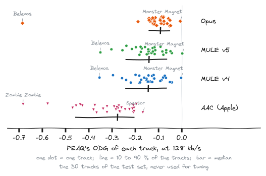
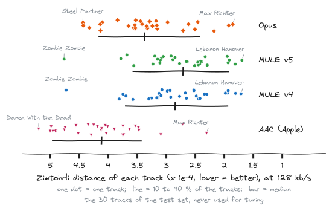

# MULE's results, version by version

The README shows the current encoder only. This page keeps the older measurements and traces how
the results moved, format by format (what the decoder reads) and encoder change by encoder change
(how the encoder spends its bits, with the format unchanged). ODG is PEAQ's score (higher is better,
0 at best), Zimtohrli a distance to the original (x 10^4, lower is better); how to read them is in
the README.

## Timeline

| Date (2026) | Version | What changed | Details |
|---|---|---|---|
| before 19/11 | format v2 | TCQ (8 states, restarted in each band), rANS with adaptive CDFs; blind ABX at 128 kb/s: told apart neither from the original nor from Opus | [`LESSONS.md`](LESSONS.md) |
| 19/11 | format v3 | 64-state trellis running across the bands, 8-symbol coefficients | [`V3-IDEAS.md`](V3-IDEAS.md) |
| 22/11 | format v4 | the noise the decoder generates in the bands left without bits | [`V4.md`](V4.md) |
| 22/11 | format v5 (frozen) | folding in short frames: from 2.8 kHz up, a band without bits takes the fine structure decoded just below it (with a little noise) instead of flat noise | [`V5.md`](V5.md) |
| 23/11 | encoder: `--bitrate` | a rate leveler that draws each track toward the requested rate | [`ENC-PARAMS.fr.md`](ENC-PARAMS.fr.md) |
| 24/11 | encoder: Opus mix (C75) | Opus's band allocation table mixed into the masks, a quarter of the weight | [`ENC-PARAMS.fr.md`](ENC-PARAMS.fr.md) |
| 25/11 | encoder: reallocation (brR128) | bits moved between bands by a law of the rate, found from Zimtohrli's slopes | [`../eval/results/B9-REPORT.md`](../eval/results/B9-REPORT.md) |
| 26/11 | encoder: exhale's ideas (prPN) | a pitch veto in the transient detector, TNS's prediction gain as a temporal cue | [`../eval/results/B9-REPORT.md`](../eval/results/B9-REPORT.md) §11-16 |

## The encoder on 299 tracks (format v5)

299 excerpts of 30 s from 144 artists, drawn at random from the library (300 drawn; c224 left out,
a recording that carries a cathode-ray monitor's 15.6 kHz whistle), each codec at the setting
whose mean rate over the excerpts is the target (interpolated), audio payload only.

| MULE v5 encoder | Zimtohrli @96 / @128 / @160 | ODG @96 / @128 / @160 | ODG (advanced) @96 / @128 / @160 |
|---|---|---|---|
| quality mode `-q` (22/11) | 6.16 / 2.76 / 1.40 | −0.37 / −0.15 / −0.01 | −0.74 / −0.33 / −0.13 |
| `--bitrate`, rate leveler (23/11) | 6.15 / 2.76 / 1.38 | −0.36 / −0.16 / −0.02 | −0.75 / −0.33 / −0.13 |
| + Opus mix C75 (24/11) | 5.86 / 2.59 / 1.32 | **−0.35** / −0.14 / **−0.01** | **−0.73 / −0.32 / −0.13** |
| + reallocation brR128 (25/11) | 5.31 / 2.47 / 1.25 | −0.36 / **−0.14** / −0.03 | −0.75 / −0.32 / −0.13 |
| + pitch veto and TNS cue (26/11, current) | **5.27 / 2.45 / 1.24** | −0.35 / **−0.14** / −0.02 | −0.74 / −0.32 / −0.13 |
| *Opus (libopus 1.6.1), for reference* | *5.82 / 3.22 / 2.14* | *−0.33 / −0.13 / 0.00* | *−0.83 / −0.44 / −0.23* |

The leveler changed little in quality (its point is the rate: 95 % of the tracks within ±10 % of
the target); the Opus mix gained on every measure; the reallocation took another 5 to 9 % off
Zimtohrli's distance, for a few hundredths of PEAQ's basic score that a blind ABX test at 96 kb/s
could not hear (46/96); exhale's two ideas added 0.7 % at every rate, the other judges stable.
Over the four steps, Zimtohrli's distance fell by 11 to 14 %.

## Formats v3 to v5 on 30 tracks (quality mode)

The first measurements, on 30 tracks drawn at random from the library and never used for tuning,
in quality mode (`-q`, before `--bitrate` existed), at equal real bitrate (curves interpolated),
compare the formats and two more codecs, FDK-AAC and Vorbis. ODG is PEAQ's score (higher is better,
0 at best), Zimtohrli a distance to the original (x 10^4, lower is better):

| | ODG @128 kb/s | ODG @160 kb/s | ODG (advanced) @128 / @160 | Zimtohrli @128 |
|---|---|---|---|---|
| AAC (FDK-AAC) | −0.54 | −0.21 | −0.57 / −0.27 | 5.08 |
| Vorbis (libvorbis) | −0.45 | −0.16 | −0.63 / −0.34 | 5.12 |
| AAC (Apple, qaac TVBR) | −0.31 | −0.02 | −0.46 / −0.22 | 4.11 |
| Opus (libopus) | **−0.12** | 0.00 | −0.45 / −0.24 | 3.32 |
| MULE (format v3) | −0.16 | 0.00 | −0.36 / −0.14 | 3.74 |
| MULE (format v4) | −0.15 | 0.00 | −0.34 / −0.14 | 2.84 |
| MULE (format v5) | −0.15 | **+0.01** | **−0.33 / −0.13** | **2.77** |

MULE beats Vorbis and FDK-AAC everywhere. Apple's AAC encoder is far ahead of FDK on the same
format (+0.23 ODG at 128 kb/s): in a codec, the encoder is what matters.

### Track by track (the same 30 tracks)

Averages hide a lot. Each dot below is one of the 30 test tracks at 128 kb/s: Opus is excellent
almost everywhere but collapses on one track (Belenos, bagpipes); MULE is more even, and v5 sits
level with v4 in PEAQ's eyes; Apple's AAC is spread wide and pays for its lowpass in PEAQ's eyes.

The same tracks seen by Zimtohrli (Google's psychoacoustic distance, lower is better; the axis is
reversed so that better stays on the right), which I trust more than PEAQ at these bitrates.
MULE v5, whose encoder was tuned on it (on other tracks), has the best median at 128 kb/s (2.71,
v4 2.85, Opus 3.38) and at 160 kb/s (1.36, v4 1.38, Opus 2.26). Zimtohrli does not pick the same
hard tracks as PEAQ: MULE's worst used to be Garbage, whose dense cymbals are noise-filled by MULE
in the top bands with the right average energy but not the right movement from frame to frame; an
envelope guard in the encoder, short blocks triggered by the highs, then the folding of v5 brought
it from 6.6 (v3) to 4.9, 3.7, then 3.1 (`eval/results/N-LOG.md`). The worst is now Zombie Zombie
(4.8), whose structured highs, under a loud band, MULE fills with noise.

