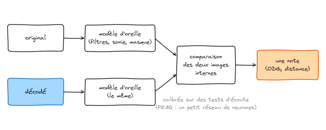
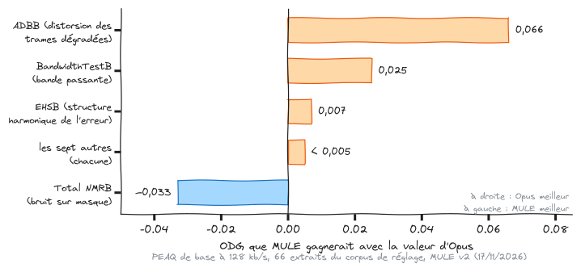
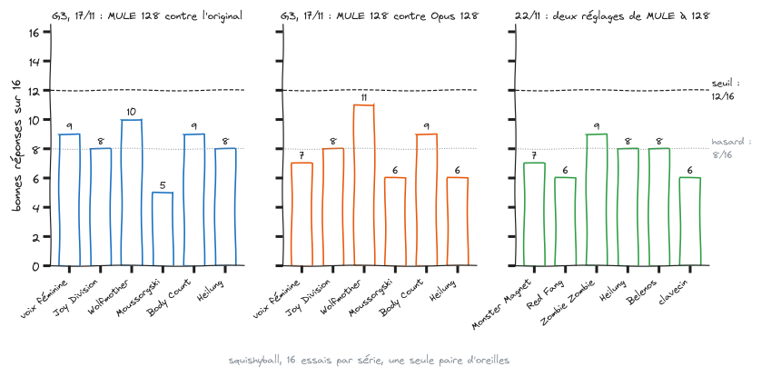

# Quand les machines écoutent à notre place

*Quatrième billet de la série « MULE, ou comment marche un codec audio moderne ». Premier jet du 24/11/2026.*

## Champagne, puis gueule de bois

Une nuit de novembre, j'ai lâché un algorithme d'optimisation sur l'encodeur de MULE. Son travail : tourner cinq boutons de réglage, encoder, faire noter le résultat, recommencer. Au bout de deux générations, il m'annonce un gain de **+0,031** sur la note de qualité. Pour situer, c'est le genre de gain pour lequel je me battais à la main pendant des jours. J'ai failli ouvrir une bouteille.

Il n'avait rien trouvé dans le codec. Il avait trouvé une faille dans ma façon de mesurer, et il l'exploitait avec l'application d'un stagiaire qui a compris comment le chef lit les rapports. On y reviendra.

Le problème de fond est simple. Régler un codec, c'est départager des milliers de variantes qui diffèrent de quelques centièmes de note. Mon oreille ne les entend pas. Et une écoute honnête, en aveugle, prend une heure par extrait, avec des oreilles reposées. Il faut donc déléguer l'écoute à des programmes : des **juges automatiques**, qui comparent le son original et le son décodé et rendent une note.

Ce billet raconte ces juges. Ils sont rapides, infatigables et reproductibles. Ils se contredisent aussi, se font berner, comptent des choses que personne n'entend et ratent des choses que j'entends. Et pourtant je ne pourrais rien faire sans eux.

## Ce qu'on demande à un juge

La première idée, la plus naïve, c'est de soustraire le décodé de l'original et de mesurer ce qui reste : le rapport signal sur bruit. C'est inutile pour un codec perceptif, qui **ajoute du bruit exprès**, là où on ne l'entend pas. Tout le billet 1 tenait là-dessus : on jette ce que le masque cache. Un bon codec a un rapport signal sur bruit médiocre, et c'est normal.

Un juge doit donc écouter comme une oreille. Ils suivent tous à peu près le même schéma : un **modèle d'oreille** (des bancs de filtres qui imitent la cochlée, une loi de sonie, un masque) transforme chaque signal en une image interne, puis on compare les deux images. Enfin, la comparaison est convertie en note, calibrée sur des tests d'écoute réels.

Les notes ne sont pas toutes sur la même échelle. PEAQ rend un **ODG** (Objective Difference Grade), de −4 (« très gênant ») à 0 (« imperceptible »), calqué sur l'échelle des tests d'écoute de l'UIT. D'autres rendent une **distance** : 0 pour deux sons identiques, et plus c'est grand, pire c'est. À 128 kb/s, tout se joue entre −0,3 et 0 d'ODG, c'est-à-dire dans la zone que les auditeurs décrivent comme « perceptible mais pas gênant » ou mieux. On se bat pour des miettes.

## Les quatre juges

**PEAQ** est l'ancêtre, normalisé par l'UIT en 1998 (BS.1387), et j'utilise l'implémentation libre GstPEAQ. Il calcule onze variables intermédiaires (les MOV, pour *Model Output Variables* : le bruit sur le masque, la bande passante, la modulation, la structure harmonique de l'erreur…), puis les passe dans un petit réseau de neurones qui rend l'ODG. Il a deux modes, de base et avancé, qui ne regardent pas les mêmes choses et ne sont pas toujours d'accord. Il a été calibré sur les codecs de la fin des années 1990, et ça se voit : près de la transparence, il sature, et il a ses marottes.

**Le NMR**, le rapport bruit sur masque, est le plus simple : pour chaque bande et chaque trame, combien le bruit dépasse le masque, en décibels. Je le calcule avec mon propre modèle psychoacoustique. C'est le juge le plus lisible, et le plus suspect, parce qu'il mesure avec la règle qui a servi à encoder (j'y reviens plus bas).

**ViSQOL**, de Google, compare des spectrogrammes et passe le résultat dans une régression. Je l'ai viré le 22 novembre : il sature près de la transparence, et ses petits reculs n'ont jamais été entendus en écoute. Il tourne encore, pour la forme, mais il n'a plus voix au chapitre.

**Zimtohrli**, de Google aussi, est le plus récent et c'est devenu mon premier juge. Son modèle d'oreille découpe le son en 128 canaux, de 18 Hz à 20 kHz, et compare les deux images avec une mesure de similarité qui sépare deux choses : l'**intensité** (est-ce que le niveau local est le même ?) et la **structure** (est-ce que la texture est la même, la façon dont l'énergie se répartit et bouge dans le temps et en fréquence ?). Cette séparation va servir à la fin du billet.

Une confession, pour l'ambiance. Pendant plusieurs jours, mes fichiers de résultats écrivaient chaque note avec quatre chiffres après la virgule. Les distances de Zimtohrli valent entre 0,0001 et 0,0009. J'ai donc soigneusement comparé des zéros entre eux, et tiré des conclusions. Personne n'est à l'abri.

| Juge | Ce qu'il mesure | Échelle | Défaut connu |
|---|---|---|---|
| PEAQ de base | 11 variables, un réseau de neurones | ODG, −4 à 0, plus haut = mieux | sature près de 0 ; compte la bande passante |
| PEAQ avancé | une autre combinaison de variables | ODG, plus haut = mieux | même âge, mêmes limites |
| NMR | le bruit au-dessus du masque, bande par bande | dB, plus bas = mieux | mon propre modèle : juge et partie |
| Zimtohrli | intensité et texture, sur 128 canaux | distance, plus bas = mieux | jeune, peu de recul publié |

## Le piège des 20 kHz

Le premier vrai diagnostic m'a appris à me méfier. À 128 kb/s, PEAQ de base mettait MULE environ 0,06 d'ODG derrière Opus. D'où venait l'écart ?

PEAQ a une propriété pratique : ses onze variables sont visibles, et son réseau de neurones est petit. On peut donc le réévaluer en remplaçant une seule variable de MULE par celle d'Opus, et voir de combien la note bouge. C'est une attribution, variable par variable.

La plus grosse part venait de la distorsion concentrée dans quelques trames, un vrai sujet, qui a nourri des semaines de travail. La deuxième était la **bande passante** : la dernière bande de MULE s'arrête à 19,95 kHz, celle d'Opus monte à environ 20,4 kHz. Ça valait 0,025 d'ODG. Personne n'entend la différence entre 19,95 et 20,4 kHz, à part peut-être les chauves-souris et les adolescents de 12 ans. J'ai quand même testé une 23e bande pour aller jusqu'au bout du spectre. Verdict : un artefact de PEAQ, pas un défaut du codec. Écartée.

La leçon vaut pour tous les juges : un juge note aussi ce qu'il sait mesurer, pas seulement ce qu'on entend. Si on optimise aveuglément sa note, on finit par coder des ultrasons pour faire plaisir à un réseau de neurones de 1998.

Remarquez aussi la barre bleue : selon le bruit sur masque total, MULE est *meilleur* qu'Opus. Le même juge, sur la même trame, voit MULE devant sur une variable et derrière sur une autre. Ce n'était qu'un avant-goût.

## Quand les juges ne sont pas d'accord

Pour mesurer MULE contre Opus et l'AAC d'Apple, j'ai fait tourner une campagne sur 300 morceaux de ma bibliothèque, tirés au hasard, chaque codec réglé pour le même débit moyen. Voici, pour chaque juge, la part des morceaux où MULE fait mieux qu'Opus.

À 96 kb/s, c'est la cacophonie. Zimtohrli voit une égalité parfaite, un morceau sur deux. PEAQ de base préfère Opus sur 70 % des morceaux. PEAQ avancé et le NMR préfèrent MULE sur 84 et 91 %. Quatre juges, trois verdicts. À 160 kb/s, ça se calme : trois juges donnent MULE devant sur 98 à 99 % des morceaux, et PEAQ de base reste obstinément à pile ou face, ce qui correspond surtout à sa saturation près de zéro.

Qui croire ? J'ai fini par écrire une règle, et par m'y tenir :

1. **Zimtohrli d'abord**, parce que c'est celui dont les verdicts collent le mieux à ce que j'entends à ces débits ;
2. puis **PEAQ** (les deux modes) et **le NMR** ;
3. un changement de l'encodeur est adopté si les juges sont d'accord et qu'**aucun extrait ne recule** ;
4. **s'ils ne sont pas d'accord, c'est l'écoute qui tranche.**

Le cas d'école, c'est le réglage `m6z1`, le 22 novembre. Zimtohrli l'aimait beaucoup : 12 à 13 % de distance en moins, meilleur sur presque tous les extraits. PEAQ de base reculait un peu, de façon cohérente. Règle non remplie, donc écoute : 96 essais en aveugle sur six extraits, 44 bonnes réponses, soit 46 %, moins bien que le hasard. Je n'entendais aucune différence, ni là où PEAQ pénalisait le réglage, ni là où Zimtohrli le favorisait. Adopté, au bénéfice de Zimtohrli.

## L'optimiseur qui triche

Revenons à ma bouteille de champagne. L'algorithme s'appelle CMA-ES : il essaie une population de réglages, garde les meilleurs, et déplace sa population vers eux, génération après génération. Il lui faut une note par candidat. Je lui avais donné « l'ODG moyen à 128 kb/s, à débit égal ».

Sauf qu'un réglage de l'encodeur change aussi le débit. Pour comparer à débit égal, j'encodais chaque candidat à deux réglages de qualité fixes, puis j'interpolais la note à 128 kb/s. Les candidats gourmands, ceux qui dépensaient plus de bits, dépassaient 128 kb/s à mes **deux** points de mesure. La note « à 128 » n'était plus interpolée, mais **extrapolée**. Et comme la courbe qualité-débit est concave, l'extrapolation surestimait.

La figure est cruelle. À gauche, le gain annoncé suit presque parfaitement le débit du candidat (corrélation de 0,8). Tous les candidats « gagnants » sont à droite de la ligne des 128 kb/s. CMA-ES n'avait pas trouvé de meilleur réglage : il avait trouvé que dépenser plus de bits faisait monter ma note, grâce à mon extrapolation. Il avait raison, d'ailleurs. C'est moi qui m'étais trompé de question.

À droite, le second essai : pour chaque candidat, je cherche d'abord les deux qualités qui donnent 120 et 136 kb/s, puis je note entre les deux. Le débit visé est toujours encadré. Meilleur gain : +0,0006, c'est-à-dire du bruit de mesure. J'ai arrêté après deux générations.

Morale : un optimiseur trouve toujours la faille de la mesure avant le gain réel, parce que c'est plus facile. Toute comparaison « à débit égal » doit encadrer le débit, pour chaque candidat. C'est aussi pour ça que mes comparaisons de codecs interpolent la note morceau par morceau, à débit moyen égal, et jamais au-delà des points mesurés.

## Noter l'élève avec son propre manuel

Il y a un biais plus sournois, que je dois avouer avant que quelqu'un ne le fasse à ma place. MULE a été réglé avec ces juges-là. Opus et AAC ont été réglés à l'oreille, pendant des années, par des gens qui savent écouter. Si MULE est devant sur ces juges, c'est en partie parce qu'il a appris à leur plaire.

Le pire, c'est le NMR. Je le calcule avec le même modèle psychoacoustique que celui qui décide, dans l'encodeur, où mettre le bruit. C'est un élève qui corrige sa copie avec son propre manuel : il aura toujours de bonnes notes. Les 91 à 99 % de victoires de MULE au NMR sur la figure 3 disent surtout que l'encodeur fait ce que son modèle lui demande.

Les garde-fous, imparfaits :
- je règle sur un groupe d'extraits (*dev*, 66 extraits), je valide sur un autre (*test*, 30), et je confirme sur une campagne de 300 morceaux que l'encodeur n'a jamais vus ;
- je regarde plusieurs juges, dont certains que je n'ai pas écrits ;
- et je fais régulièrement passer le tout devant une paire d'oreilles.

Ça ne supprime pas le biais. Ça l'empêche de tout décider.

## La cour d'appel : l'ABX

Quand les juges ne sont pas d'accord, ou quand je veux savoir si un écart s'entend, je fais un test **ABX**. Le programme (squishyball) me fait écouter A, B, puis X, qui est l'un des deux, tiré au hasard. Je dois dire lequel. Seize essais par série ; il faut au moins **12 bonnes réponses sur 16** pour que le résultat ait moins de 5 % de chances d'être dû au hasard. Au hasard pur, on tourne autour de 8.

Le 17 novembre, j'ai pris les six extraits où PEAQ voyait le plus grand écart entre MULE et Opus. Contre l'original, MULE à 128 kb/s : rien d'entendu, au mieux 10/16 sur Wolfmother. MULE contre Opus au même débit : rien, au mieux 11/16, toujours Wolfmother. L'écart que PEAQ mesurait, environ 0,05 d'ODG, ne s'entend pas, du moins pas par moi. Même verdict pour les deux réglages du 22 novembre : 44/96.

Mention spéciale pour Joy Division, présent dans cette série : c'était l'un des pires extraits de MULE face à Opus selon PEAQ en novembre, et c'est le pire de toute la campagne de 300 morceaux face à Opus. En ABX : 8/16 contre l'original, 8/16 contre Opus, le hasard parfait. Et en y regardant de plus près, c'est un enregistrement live de 1980, saturé jusqu'à la moelle. Les juges s'acharnent sur un morceau dont la source est déjà abîmée.

Il faut dire les limites de cette cour d'appel. C'est une seule paire d'oreilles, la mienne, un seul casque, et des séances d'une heure. Les oreilles se fatiguent. Elles ont aussi une vie : le matin où j'ai voulu faire l'ABX du morceau le plus intéressant de la campagne, je sortais d'un concert de cornemuses, joué très fort, et j'avais les oreilles qui sifflaient. Séance annulée. Un juge automatique n'a jamais d'acouphènes.

Ce que ces écoutes disent, au fond : à 128 kb/s, MULE, Opus et l'AAC d'Apple sont probablement transparents pour moi sur presque tout. On se bat pour des écarts que seuls les programmes voient. Ce n'est pas inutile pour autant : ces écarts deviennent audibles à plus bas débit, et ils indiquent où le codec est faible.

## Regarder où le juge a mal

Une moyenne sur 300 morceaux cache tout. La seule façon d'apprendre quelque chose d'un juge, c'est de descendre : au morceau, puis à la seconde, puis à la fréquence.

Parmi les rares défaites de MULE face à Opus, il y a une ode de Purcell, du chant choral avec un ensemble baroque. Pas de défaut d'enregistrement, et une défaite à tous les débits selon Zimtohrli, alors que PEAQ avancé et le NMR préfèrent MULE. Je ne peux pas vous montrer cet extrait, qui est sous droits, mais le même phénomène se voit sur le quatuor à cordes de la collection EBU SQAM, au même débit pour les deux codecs.

En haut, Zimtohrli seconde par seconde. Sur Purcell, MULE était derrière sur 58 fenêtres sur 59 : pas un accident localisé, mais un défaut permanent. En bas, la décomposition par région : la perte se concentre entre 2,8 et 6 kHz et entre 10 et 15 kHz, et elle est presque entièrement dans la **structure**. La part d'intensité est si petite qu'elle disparaît sur la figure. Autrement dit, MULE met la bonne *quantité* de bruit, mais pas avec la bonne *texture*.

J'ai d'abord soupçonné un papillotement : certaines bandes, juste au bord du masque, passaient d'une trame à l'autre de « codée » à « remplie de bruit ». C'était vrai, une bande sur Purcell basculait dans 21 % des trames. J'ai ajouté une hystérésis pour stabiliser ces décisions : le papillotement est tombé à 8 %, et la note n'a pas bougé (10,98 → 10,89). Sur les 66 extraits du groupe de réglage, l'effet est de l'ordre du pour cent. Fausse piste. J'ai ensuite fait varier le niveau du bruit de remplissage : le réglage actuel était déjà le meilleur. Deuxième fausse piste.

L'hypothèse qui reste : dans ces régions, MULE code peu d'impulsions (un tiers des coefficients d'une bande codée sont non nuls) et remplit le reste avec du bruit plat. Opus, lui, remplit les trous en **repliant** du spectre déjà décodé, étale ses impulsions et conserve exactement l'énergie de chaque bande : son remplissage a la texture du signal. MULE sait replier aussi, mais seulement dans les trames courtes, celles des attaques. C'est une hypothèse cohérente avec les mesures, pas une démonstration, et la corriger demanderait de toucher au format.

Dernière anecdote de cette plongée : sur un autre extrait perdant, un concerto de Beethoven, la différence entre les deux codecs se résumait au niveau du bruit qu'ils mettent à la place du souffle de l'enregistrement, au-dessus de 12 kHz. Dans ce souffle, une raie fine, à **15 625 Hz** pile. C'est la fréquence de balayage des lignes d'un téléviseur cathodique au standard européen. Il y avait une télé allumée dans la salle d'enregistrement, et j'ai déjà croisé la même raie sur un autre Beethoven. Les juges mesurent tout, y compris la télé du preneur de son.

## Conclusion : des juges, pas des oracles

Les juges automatiques sont indispensables pour régler un codec, et dangereux pour conclure. Ils notent ce qu'ils savent mesurer, pas forcément ce qu'on entend. Ils se contredisent. Ils se font exploiter par le premier optimiseur venu. Et ils favorisent le codec qui a été réglé avec eux.

Ce que j'en ai tiré tient en quatre règles : plusieurs juges, une hiérarchie annoncée d'avance, des statistiques sur beaucoup de morceaux, et l'oreille en dernier ressort, de préférence reposée. Et une cinquième, peut-être la plus utile : quand un juge dit qu'on perd, ne pas regarder la moyenne, mais aller voir **où** il a mal. C'est là qu'on apprend quelque chose sur son codec, même quand on ne l'entend pas.

Dans le prochain billet, je vous ouvre le cimetière : toutes les bonnes idées que ces juges ont refusées.

## Notes pour la relecture (à retirer avant publication)

- Chiffres : figure 2, `eval/results/E2-LOG.md` (MULE v2, 17/11) ; figure 3, campagne de 300 morceaux,
  mode `--bitrate` (mélange Opus C75) ; figure 4, `m6_search_extrapolated.csv` et `m6_search.csv` ;
  figure 5, `G3-ABX.md` et `N-LOG.md` (m6z1) ; figure 6, `docs/blog/tools/figs4.py` (quatuor SQAM,
  MULE 6,67 contre Opus 6,26 en moyenne des fenêtres, 91,9 kb/s chacun).
- Purcell (58 fenêtres sur 59, hystérésis 21 → 8 %, 10,98 → 10,89) : analyses du 24/11, fichiers dans
  `data/listen/c75opus/` (non publiés).
- À vérifier : la date et la licence de Zimtohrli ; l'année de PEAQ (BS.1387 de 1998, révisé en 2001) ;
  l'ABX de Purcell, à faire oreilles reposées, à ajouter à la section ABX.
- L'anecdote du concert de cornemuses : à confirmer ou retirer par l'auteur.
- La règle « aucun extrait ne recule » : le seuil exact est 0,02 d'ODG (mémoire de projet), à préciser ?
