# Derrière chaque format se cache un encodeur

*Cinquième billet de la série « MULE, ou comment marche un codec audio moderne ». Premier jet.*

## Même format, deux encodeurs

Prenez le format [AAC](https://fr.wikipedia.org/wiki/Advanced_Audio_Coding). Un seul format, un seul décodeur de référence, des milliards d'appareils qui le lisent. Encodez les mêmes morceaux à 128 kb/s avec [FDK-AAC](https://fr.wikipedia.org/wiki/Fraunhofer_FDK_AAC), l'encodeur libre de Fraunhofer, puis avec celui d'Apple. Le décodeur est le même, les fichiers sont tous conformes, et pourtant l'écart est énorme.

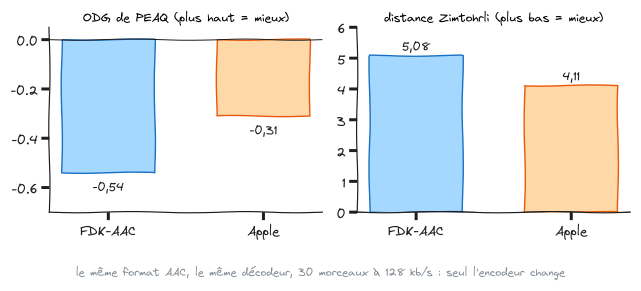

C'est voulu. Une norme comme celle de [MPEG](https://fr.wikipedia.org/wiki/Moving_Picture_Experts_Group) ne fixe que le décodeur : ce qu'il doit faire de chaque bit qu'il reçoit. Elle ne dit pas comment choisir ces bits. Le format est une langue ; l'encodeur est celui qui écrit. Avec la même grammaire, on peut écrire Flaubert ou une notice de montage.

Le 22 novembre, j'ai figé le format de MULE (la v5). Plus un bit ne bouge côté décodeur : le baladeur peut lire les fichiers d'aujourd'hui comme ceux de dans dix ans. Ce billet raconte les cinq jours suivants, passés uniquement dans l'encodeur. Résultat : la distance Zimtohrli (le juge en qui j'ai le plus confiance, voir le billet 4) a baissé de 11 à 14 % selon le débit, sans toucher à une ligne du décodeur.

## Ce que décide l'encodeur

Le billet 1 décrivait le trajet d'une trame. Reprenons-le en surlignant ce que le format laisse libre.

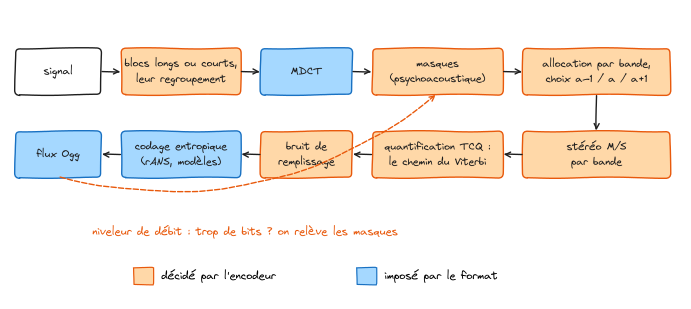

Presque tout est orange. Le format impose la [MDCT](https://fr.wikipedia.org/wiki/Transform%C3%A9e_en_cosinus_discr%C3%A8te_modifi%C3%A9e), la façon d'écrire les nombres et le conteneur. Il ne dit rien de :

- **quand passer en blocs courts**, et comment les regrouper ;
- **le masque**, c'est-à-dire combien de bruit chaque bande peut cacher ;
- **l'allocation**, et le petit arbitrage débit-distorsion qui hésite, bande par bande, entre trois niveaux ;
- **le chemin dans le treillis** de la quantification (billet 2) ;
- **la stéréo**, gauche-droite ou milieu-côté, bande par bande ;
- **le niveau du bruit** qui remplit les trous ;
- **le débit**, enfin.

Le décodeur obéit sans discuter. Il ne sait pas pourquoi l'encodeur a choisi ces bits-là, et il s'en moque. C'est toute la beauté de la chose : tant que le flux est valide, on peut changer l'encodeur autant qu'on veut. Et c'est tout le danger : on peut aussi le dérégler autant qu'on veut, sans qu'aucun test de conformité ne bronche.

## Descendre extrait par extrait

La première leçon de ces journées est vieille comme les statistiques : la moyenne cache tout. Une note moyenne sur 30 morceaux bouge d'un centième ; derrière, un morceau gagne 0,3 et vingt-neuf ne bougent pas. Il faut regarder les morceaux un par un, puis les passages un par un.

Le jour où je l'ai fait, trois morceaux tiraient MULE vers le bas : Lebanon Hanover, Zombie Zombie et Takemitsu. Une cold wave berlinoise, un duo de synthés français et un compositeur japonais contemporain, ligués contre un modèle psychoacoustique que j'avais réglé au décibel près. Je ne sais pas ce qu'ils avaient contre moi.

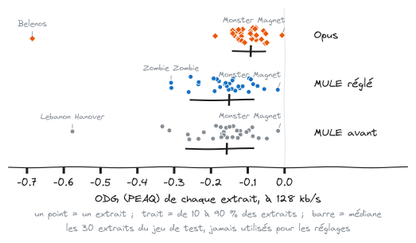

**Lebanon Hanover** perdait 0,55 d'ODG, là où les autres étaient vers −0,15. La cause : le regroupement des blocs courts. Quand une attaque arrive, l'encodeur passe en huit petits blocs, puis regroupe ceux qui se ressemblent pour ne payer qu'une fois les informations de bord. « Se ressemblent » voulait dire : même énergie totale, à 6 dB près. Or l'énergie de ce morceau est écrasée par les graves, 46 dB sous 100 Hz. Un coup de charleston dans les aigus ne la fait pas bouger : les blocs calmes étaient groupés avec celui de l'attaque, et le bruit de l'attaque s'étalait sur toute la trame. Correction : comparer quatre régions de fréquence séparément au lieu de l'énergie totale. Lebanon Hanover gagne 0,31, les 29 autres ne bougent pas, le débit non plus. Ce seul défaut expliquait un quart de l'écart moyen avec Opus. Validé à l'écoute, ce qui est rare.

**Le détecteur d'attaques**, lui, prenait les voix pour des percussions. Il compare chaque tranche de 2,9 ms à une mémoire de l'énergie récente, qui s'efface de 3 dB par tranche. Entre deux impulsions de la glotte (toutes les 8 ms pour une voix à 120 Hz), la mémoire s'effaçait assez pour que l'impulsion suivante passe pour une attaque. Résultat : un cinquième des trames d'une voix parlée en blocs courts, qui coûtent plus cher et sonnent moins bien sur un son tenu.

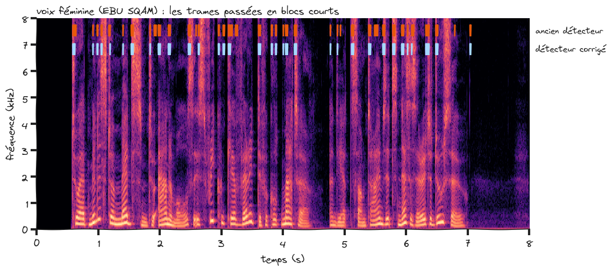

Ce défaut était là depuis le premier jour. Je l'ai trouvé parce qu'une correction ailleurs faisait *baisser* la note des voix, et que j'ai demandé pourquoi au lieu de jeter la correction. Les plus vieilles briques sont celles qu'on ne regarde plus.

## Viser un débit, pas une qualité

Jusque-là, MULE ne connaissait qu'un réglage : une cible de qualité (`-q`), en décibels sous le masque. Chaque morceau prend le débit qu'il lui faut. C'est honnête, mais c'est inutilisable pour comparer : à « `-q −6` », un morceau de piano seul sort à 70 kb/s et un morceau de metal à 150. Et c'est pénible à utiliser : personne ne sait ce que veut dire « −6 dB sous le masque », tout le monde sait ce que veut dire « 128 kb/s ».

J'ai donc ajouté `--bitrate`, comme `opusenc`. Deux étages :

1. **Une courbe**, mesurée sur 300 morceaux, donne la qualité qui produit en moyenne le débit demandé : R(q) = 76,4 × 2−q/9,21 kb/s.
2. **Un niveleur** corrige ensuite chaque morceau en cours de route. Si le débit lissé dépasse la cible, il relève les masques (on tolère plus de bruit) ; s'il est en dessous, il les abaisse. Il ne corrige que les deux tiers de l'écart, et jamais plus de 15 dB : on veut rapprocher les morceaux de la cible, pas les y clouer. C'est le principe du [débit variable](https://fr.wikipedia.org/wiki/D%C3%A9bit_binaire_variable) contraint d'Opus, en plus mou.

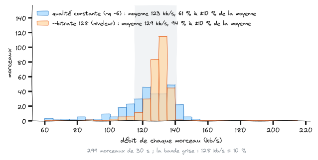

En qualité constante, 61 % des morceaux tombent à ±10 % de leur moyenne ; avec le niveleur, 94 %. Et à débit moyen égal, la qualité ne bouge presque pas (à 1 % près sur Zimtohrli). C'est un outil de confort, pas d'amélioration. Mais c'est lui qui rend possible tout ce qui suit : comparer deux réglages « à 128 kb/s », c'est enfin comparer des fichiers qui font vraiment 128 kb/s.

## Emprunter le goût d'Opus

Opus contient un petit tableau, `band_allocation` : pour chaque bande et chaque niveau de débit, combien de bits lui donner d'office. Ce tableau n'a rien de psychoacoustique au sens savant. C'est un résumé de dix ans d'écoutes par des gens qui avaient de meilleures oreilles que moi : une [heuristique](https://fr.wikipedia.org/wiki/Heuristique) en dur, très bien réglée.

Premier essai : remplacer mes masques par ce tableau. Catastrophe : +60 % de distance Zimtohrli. Le tableau est fait pour la structure d'Opus (ses bandes, ses tailles de trame, ses outils), pas pour la mienne.

Deuxième essai : le mélanger. Chaque masque devient une moyenne pondérée, en décibels, entre mon modèle (75 %) et le tableau d'Opus (25 %). Un peu de goût d'Opus, sans renier ma cuisine.

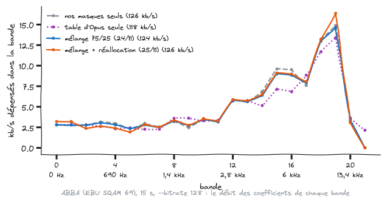

Sur un morceau, les courbes se ressemblent : on déplace quelques centaines de bits par seconde d'une bande à l'autre. Sur 299 morceaux, le mélange gagne sur tous les juges à la fois, à tous les débits : 4 à 6 % de distance Zimtohrli en moins, et un centième de PEAQ en plus. Le genre de gain qu'aucun de mes réglages manuels n'avait obtenu en une semaine.

Il y a là une leçon d'humilité : le meilleur réglage de mon modèle psychoacoustique consistait à l'écouter un peu moins.

## Demander au juge où mettre les bits

Le mélange avec Opus marchait, mais je ne savais pas *pourquoi*. Quelles bandes avaient trop de bits, lesquelles pas assez ? J'avais essayé de répondre avec [CMA-ES](https://fr.wikipedia.org/wiki/CMA-ES), l'optimiseur du billet 4, en lui donnant neuf boutons de réglage et une nuit par débit. Il a trouvé 1 à 2,5 % de gain sur ses extraits d'entraînement… qui se sont évaporés sur les autres. Sur 300 morceaux, son réglage à 128 kb/s ne gagnait rien sur Zimtohrli et perdait sur PEAQ pour 94 % des morceaux. Un élève qui apprend les corrigés par cœur.

Alors j'ai posé la question directement au juge. La méthode est simple :

1. On découpe le spectre en sept régions, celles de Zimtohrli.
2. Dans une région, on décale les masques de ±3 dB : un peu plus de bits, un peu moins.
3. On mesure ce que ça coûte en débit et ce que ça rapporte en distance Zimtohrli. Le rapport des deux est une **pente** : ce qu'un kb/s achète dans cette région.

Si l'encodeur répartissait ses bits comme le juge le voudrait, toutes les pentes seraient égales : un kb/s rapporterait autant partout, et déplacer des bits ne servirait à rien. C'est la condition d'optimum d'une répartition, celle de tout bon [problème d'allocation](https://fr.wikipedia.org/wiki/Multiplicateur_de_Lagrange). Elles ne l'étaient pas du tout.

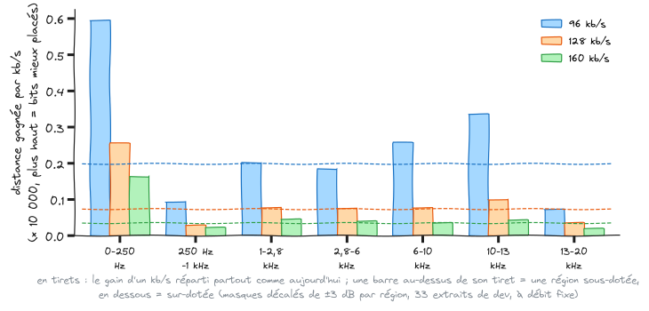

Le diagnostic, le même aux trois débits :

- **les graves (sous 250 Hz) manquent de bits** : un kb/s y rapporte trois à cinq fois plus que la moyenne ;
- **le bas-médium (250 Hz à 1 kHz) en a trop** : un kb/s y rapporte environ deux fois moins ;
- **de 1 à 13 kHz**, un peu sous-doté ;
- **au-dessus de 13 kHz, trop de bits**, surtout à bas débit.

On en tire une réallocation : prendre au bas-médium et à l'aigu, donner aux graves et au milieu. À 128 kb/s, le modèle prédisait −7,9 % de distance sur les extraits qui avaient servi à mesurer ; sur des extraits jamais vus, on a mesuré −7,7 %. CMA-ES, avec ses neuf boutons, ne pouvait pas trouver ça : aucun de mes réglages ne savait déplacer des bits d'une région à l'autre. On ne trouve pas une porte en cherchant dans la mauvaise pièce.

### Les juges se fâchent sur l'aigu

La partie sous 13 kHz est passée sans histoire : −5 % de distance à tous les débits, PEAQ à deux centièmes près. L'aigu, c'est autre chose.

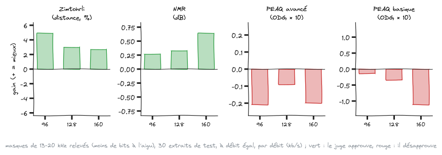

Zimtohrli et le NMR disent : ces bits sont mieux employés ailleurs. PEAQ dit : vous abîmez l'aigu. C'est le piège des 20 kHz du billet 4, vu de l'autre côté. Quand les juges se disputent, la règle de ce projet est simple : on écoute.

J'ai préparé six extraits choisis pour être difficiles (castagnettes, une voix, du rock, des cornemuses, des synthés, un orchestre), encodés à 96 kb/s avec et sans la réduction de l'aigu, et je me suis assis devant le PC pour un [test ABX](https://fr.wikipedia.org/wiki/Test_ABX). Score : **46 bonnes réponses sur 96**. Le hasard pur aurait donné 48. Mes oreilles ne font pas la différence ; vu leur état, ce n'est pas une preuve absolue, mais c'est la meilleure que j'aie.

### Une loi en fonction du débit

Restait à décider *combien* retirer à l'aigu, et à quel débit. Les mesures le disaient clairement : à 96 kb/s, retirer des bits à l'aigu est un gain net ; à 160 kb/s, ça n'apporte plus rien à Zimtohrli et ça coûte cher en PEAQ. D'où une loi : la réallocation sous 13 kHz à tous les débits, et l'aigu allégé à bas débit seulement, de moins en moins jusqu'à 128 kb/s.

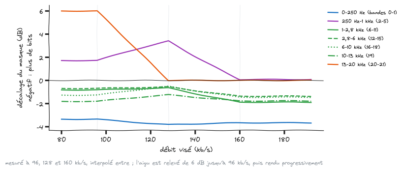

Je suis assez content de ce qu'on voit là, parce que je ne l'ai pas inventé : c'est exactement ce que font les autres encodeurs. L'AAC d'Apple coupe l'aigu, d'autant plus bas que le débit baisse. Opus réserve ses bandes hautes aux débits confortables. J'ai mis cinq jours et plus de 10 000 encodages à redécouvrir ce que leurs auteurs savaient, mais au moins maintenant je sais pourquoi.

## Ce qui n'a rien donné

En vrac, et en bref :

- **CMA-ES débit par débit** : déjà dit, des gains qui ne survivent pas à la validation.
- **Une hystérésis sur les allocations**, pour empêcher une bande de s'allumer et de s'éteindre d'une trame à l'autre (le scintillement de Purcell, billet 4) : aucun gain mesurable.
- **Le pire morceau de la campagne**, un concerto de Beethoven, était pire pour une raison idiote : l'enregistrement contient le sifflement du balayage d'un moniteur cathodique à 15,6 kHz, 50 dB au-dessus du bruit de fond. Zimtohrli le prend pour de la musique et punit quiconque y touche. Je l'ai retiré de la campagne. C'est le deuxième Beethoven de ce projet à siffler comme une télé ; je commence à soupçonner les preneurs de son de l'époque d'avoir enregistré devant le journal télévisé.

## Le bilan

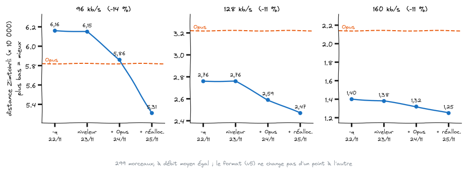

Quatre étapes, un format qui ne bouge pas, et la distance baisse de 11 à 14 %. Le niveleur ne gagne rien, mais il rend les mesures honnêtes. Le mélange avec Opus et la réallocation font le reste.

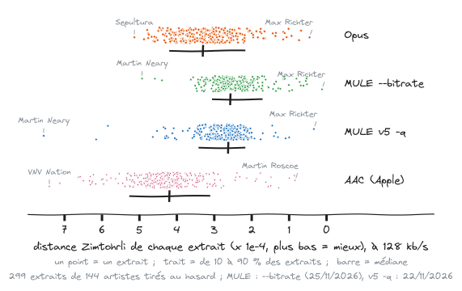

Face à Opus, à débit égal, MULE est maintenant plus proche de l'original pour Zimtohrli à tous les débits : 9 % à 96 kb/s, 23 % à 128, 42 % à 160. PEAQ avancé est d'accord. PEAQ basique donne l'égalité à 128 kb/s et deux à trois centièmes d'avance à Opus ailleurs. Ce sont des juges, pas des oreilles : à 128 kb/s, je ne distingue ni l'un ni l'autre de l'original.

Il faut garder la mesure. Opus fait tout ça à faible latence, de 6 à 510 kb/s, de la parole à la musique, sur des milliards d'appareils. MULE fait une seule chose, de la musique stockée entre 96 et 160 kb/s, sur un baladeur. Et surtout, Opus a plus de dix ans d'encodeur derrière lui. C'est la vraie leçon de ce billet : un format se fige en une journée, un encodeur s'améliore pendant des années. FDK et Apple en sont la preuve sur AAC ; MULE vient d'en faire l'expérience en cinq jours.

Le décodeur de MULE, lui, n'a pas changé d'un bit. Le baladeur n'en sait rien. Il joue juste un peu mieux.

---

## Notes pour la relecture (à retirer avant publication)

- Chiffres, par figure : 1, `docs/RESULTS-HISTORY.md` (tableau des formats, 30 morceaux) ; 3,
  `eval/results/N-LOG.md` (20/11/2026 : Lebanon −0,545 → −0,232, +0,31 pour +0,7 % de débit ; sur
  `test`, +0,012 en moyenne à 128 kb/s, le gain venant de Lebanon +0,33) ; 4, `docs/V5.md`, `docs/LESSONS.md`
  (mémoire 3 dB → 1 dB par bloc de 128 échantillons ; un cinquième des trames d'une voix ; 65 contre 51
  trames courtes sur les 8 premières secondes) ; 5, `data/campaign/results.csv` (`-q −6` contre
  `mule-br_128`, 299 morceaux ; P5-P95 91-142 contre 115-137 kb/s) ; 6, trace de l'encodeur sur ABBA ;
  7, `eval/results/slopes_summary.json` et `B9-REPORT.md` §4 (−7,9 % prédit, −7,7 % mesuré sur la
  moitié impaire de `dev`) ; 8, `B9-REPORT.md` §7 (`test`) ; 9, `params.realloc_db` ; 10 et 11,
  rapports de campagne sur 299 morceaux (`docs/RESULTS-HISTORY.md`).
- « Table d'Opus seule : +60 % » : sonde `brA` sur `dev` (`eval/results/opa_dev.csv`), 4,8 contre
  3,0, à 121 contre 126 kb/s : pas exactement à débit égal.
- « Un quart de l'écart avec Opus » : README (« about a quarter of the gap to Opus came from one
  track »), époque de la v3 ; à revérifier dans `N-LOG.md` avant publication.
- « Le niveleur ne gagne rien » : à débit égal, Zimtohrli 6,16 → 6,15, 2,76 → 2,76, 1,40 → 1,38 ;
  PEAQ basique −0,37 → −0,36, −0,15 → −0,16, −0,01 → −0,02.
- « Le mélange gagne sur tous les juges » : 299 morceaux, `mule_br` contre `mule_brC75`
  (`report_mule-mule_br-mule_brC75-opus-aac.md`) : Zimtohrli −4,7 / −6,2 / −4,3 % ; PEAQ basique
  +0,012 / +0,015 / +0,008.
- CMA-ES : 2,4 / 1,2 / 2,3 % sur la recherche (`B9-REPORT.md` §1) ; à 128 kb/s sur 300 morceaux,
  Zimtohrli −0,004 (n.s.), PEAQ basique −0,043 sur 94 % des morceaux (§3).
- Pentes (figure 7) : graves 3,0 / 3,5 / 4,7 fois la pente uniforme ; bas-médium 0,47 / 0,38 / 0,63.
- « −5 % sous 13 kHz » : campagne `brS` (§6 de `B9-REPORT.md`, 300 morceaux : −5,3 / −4,7 / −5,7 %).
- « Deuxième Beethoven qui siffle » : Beethoven 59 (`docs/V4.md`, raie à 15,61 kHz) et c224 de la
  campagne (concerto n° 5, enregistrement de 1979).
- Le billet 4 a déjà montré la raie de Beethoven (figure 9) : ici, une phrase et pas de figure.
- ABX : kit `data/listen/hf96` (non publié, musique sous droits), `brF96` contre la production,
  16 essais par extrait, 25/11/2026.
- Opus « de 6 à 510 kb/s » : RFC 6716. « Apple coupe l'aigu d'autant plus bas que le débit baisse »,
  « Opus réserve ses bandes hautes aux débits confortables » : vrais dans les grandes lignes (filtre
  passe-bas d'Apple, table `band_allocation` d'Opus à zéro dans les bandes hautes aux bas débits), à
  sourcer avant publication.
- « −5 % sous 13 kHz, PEAQ à deux centièmes près » : PEAQ basique −0,02 à 160 kb/s pour `brS`.
