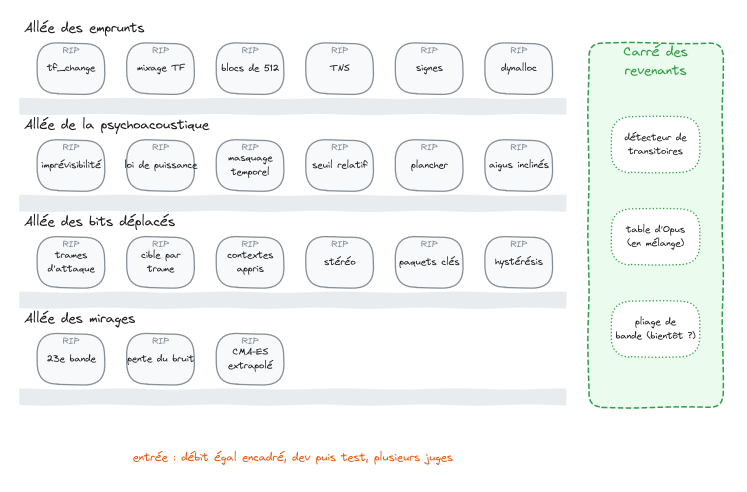
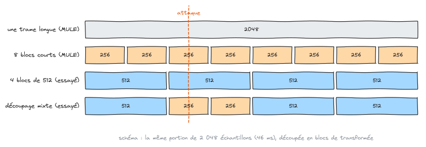
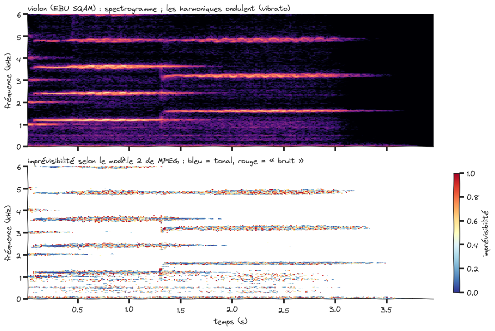
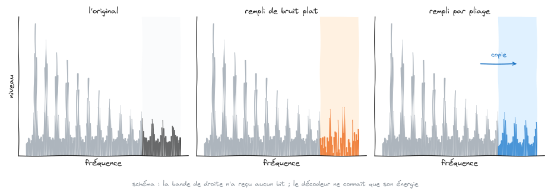
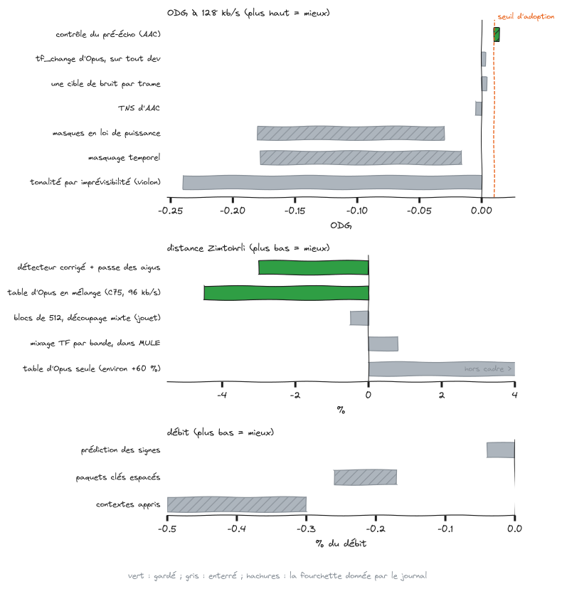

# L'ossuaire des bonnes idées

*Cinquième billet de la série « MULE, ou comment marche un codec audio moderne ». Premier jet.*

## Bienvenue

Tout [codec](https://fr.wikipedia.org/wiki/Codec) a son cimetière. Celui de MULE est rangé, daté, chiffré : chaque idée y repose avec la mesure qui l'a tuée. Il y en a bien plus que d'idées gardées.

Aucune n'était stupide. Elles venaient d'[Opus](https://en.wikipedia.org/wiki/Opus_(audio_format)), d'[AAC](https://fr.wikipedia.org/wiki/Advanced_Audio_Coding), de livres de [psychoacoustique](https://fr.wikipedia.org/wiki/Psychoacoustique) ou de mon propre cerveau à deux heures du matin. Elles avaient toutes une bonne raison de marcher. Elles sont mortes quand même, d'une cause que le billet 4 a décrite : à débit égal, sur des extraits qu'elles n'avaient jamais vus, devant plusieurs juges, elles ne faisaient pas mieux que l'existant.

Visite guidée. Pour chaque tombe : l'idée, sa cause de décès, son épitaphe.

## Allée des emprunts

Les grands codecs ont des outils éprouvés. Les copier semble la voie royale. C'est souvent une impasse, parce qu'un outil répond aux problèmes du codec qui l'a inventé.

**`tf_change`, d'Opus.** Dans une trame longue, une [transformée de Haar](https://fr.wikipedia.org/wiki/Ondelette_de_Haar) échange, bande par bande, de la finesse en fréquence contre de la finesse en temps. Sur le rock dense et saturé, là où MULE perdait encore face à Opus, elle a fait exactement ce qu'on espérait : +0,026 d'ODG. Partout ailleurs, elle a coûté des bits. Avec un réglage choisi trame par trame, il restait +0,003 sur l'ensemble des extraits, sous le seuil d'adoption.
*Épitaphe : elle marchait, elle ne payait pas.* Opus travaille sur des trames de 20 ms à bas débit ; MULE sur des fenêtres de 46 ms à 128 kb/s. Le problème que `tf_change` résout chez Opus, MULE ne l'a presque pas.

**Le mixage temps-fréquence par bande, façon [CELT](https://fr.wikipedia.org/wiki/CELT).** Même idée, dans les trames courtes cette fois. Sur un codec jouet, jugé par Zimtohrli : −0,5 % de distance, sans régression. Prometteur. Une fois dans MULE : +0,8 %, c'est-à-dire pire, et tous les juges d'accord pour le dire.
*Épitaphe : le jouet n'avait ni le [codage entropique](https://fr.wikipedia.org/wiki/Codage_entropique) ni le bruit de remplissage de MULE.* Un prototype simplifié mesure surtout ce qu'il a simplifié.

**Les blocs de 512 points**, à mi-chemin entre la fenêtre longue (2048) et les blocs courts (256). Uniformes, ils ne gagnent rien : ils aident les attaques douces et ruinent les franches. En découpage mixte, 0,5 %. Pas de quoi changer un format pour ça.

**Le [TNS](https://en.wikipedia.org/wiki/Temporal_noise_shaping), d'AAC**, qui façonne le bruit dans le temps à l'intérieur d'une trame. Implémenté, vérifié bit à bit, puis mesuré : −0,005 d'ODG au mieux. Un travail soigné pour un résultat négatif, la spécialité de la maison.

**La prédiction des signes, façon AAC Main.** Déjà racontée au billet 3 : 0,05 kb/s gagnés, soit un vingtième de pour mille du débit.

**Le dynalloc d'Opus**, qui donne plus de bits aux bandes qui dépassent l'enveloppe spectrale. Gardé en option. Jamais activé. C'est une tombe avec une plaque « provisoire ».

Et pour finir l'allée, une tombe vide. **La table d'allocation d'Opus**, qui dit combien de bits chaque bande mérite à un débit donné. Mise à la place de notre modèle psychoacoustique, elle a été une catastrophe : 60 % de distance Zimtohrli en plus. Enterrée. Puis exhumée, et mélangée à un quart de dose avec notre modèle : meilleure sur tous les juges, sur 300 morceaux. C'est aujourd'hui le réglage par défaut.
*Épitaphe : morte seule, vivante en alliage.*

## Allée de la psychoacoustique

Ici reposent les idées qui sonnent juste. Elles sortent de la littérature, elles ont des équations, et certaines ont même un nom propre.

**La tonalité par imprévisibilité**, du modèle psychoacoustique 2 de [MPEG-1](https://fr.wikipedia.org/wiki/MPEG-1). Un son tonal se prédit d'une trame à l'autre, un bruit non : on mesure la prédictibilité et on en déduit le masquage. Élégant. Sauf que le [vibrato](https://fr.wikipedia.org/wiki/Vibrato) d'un violon se prédit mal, et passe donc pour du bruit. Le modèle lui retire sa protection, et l'encodeur le maltraite : violon et trompette perdent 0,24 d'ODG.
*Épitaphe : le vibrato n'est pas du bruit, même pour un modèle.*

**Additionner les masques en [loi de puissance](https://fr.wikipedia.org/wiki/Loi_de_puissance)**, comme le recommandent plusieurs articles, plutôt que de prendre le plus fort. Entre −0,03 et −0,18 d'ODG selon l'exposant.

**Le [masquage temporel](https://en.wikipedia.org/wiki/Auditory_masking)**, qui laisse un son fort masquer ce qui le suit. Il existe, il est documenté, et l'intégrer au modèle a fait perdre jusqu'à 0,18 d'ODG. MULE gère déjà le temps par ses blocs courts, et le juge n'a pas apprécié qu'on compte deux fois la même chose.

**Le [seuil d'audition](https://fr.wikipedia.org/wiki/Seuil_d%27audition) relatif**, de [Vorbis](https://fr.wikipedia.org/wiki/Vorbis) et [LAME](https://fr.wikipedia.org/wiki/LAME) : un passage calme sera écouté plus fort, donc on y abaisse le seuil d'audition. Résultat : 2 à 3 % de bits en plus, pour une note qui progresse moins que ce que ces bits auraient rapporté ailleurs.

**Le plancher de bande** et **l'inclinaison des aigus**, deux réglages de la répartition du bruit essayés cette semaine. Rien. Pas même une régression intéressante.

**L'étalement de Terhardt**, qui fait dépendre le masquage du niveau. Seul, neutre. En hybride, au-delà de 2 [Bark](https://en.wikipedia.org/wiki/Bark_scale), il est gardé. Une demi-tombe.

Le contrepoint, pour être honnête : le seul gain franc de psychoacoustique est venu d'un défaut *mesuré*, pas d'un livre. Sous 2 kHz, une bande de MULE couvre près de 2 Bark, et son masque laissait passer du bruit autour des notes graves isolées. Des masques calculés raie par raie : jusqu'à +0,2 d'ODG sur un orchestre.
*Épitaphe générale de l'allée : un modèle juste ailleurs peut être faux ici.*

## Allée des bits mieux placés… ailleurs

Une fois l'encodeur réglé, on peut toujours se dire que les bits seraient mieux ailleurs. Ici reposent ces déménagements.

| Idée | Ce qu'elle a donné |
|---|---|
| Plus de bits aux trames d'attaque | au niveau du bruit de mesure |
| Une cible de bruit différente par trame | +0,004 d'ODG, dans le bruit de mesure, avec des régressions |
| Des contextes appris pour le codage entropique | −0,3 à −0,5 % de débit |
| Mieux exploiter la [stéréo](https://fr.wikipedia.org/wiki/St%C3%A9r%C3%A9ophonie) au-dessus de 8 kHz | au plus 2 à 3 % du débit, avant les pertes |
| Des paquets clés deux à quatre fois plus espacés | −0,17 à −0,26 % de débit |
| Stabiliser les bandes qui papillotent (Purcell, billet 4) | le papillotement passe de 21 à 8 %, la note ne bouge pas |

*Épitaphe collective : près de l'optimum, on se bat pour des fractions de pour cent.* Ces idées n'étaient pas fausses. Elles arrivaient simplement après la bataille.

## Allée des mirages

Ici, les idées qui n'ont trompé que les juges.

**La 23e bande**, pour coder jusqu'à 22 kHz. [PEAQ](https://en.wikipedia.org/wiki/Perceptual_Evaluation_of_Audio_Quality) la récompensait à bas débit et la pénalisait à haut débit. Personne ne l'entendait, ni dans un sens ni dans l'autre. Le billet 4 a raconté l'histoire.

**La pente spectrale du bruit de remplissage**, qui rendait le spectre du bruit plus fidèle à l'original. Plus juste sur le papier, sans le moindre gain mesuré. La fidélité n'est pas la qualité.

**Le gain de +0,031 trouvé par [CMA-ES](https://fr.wikipedia.org/wiki/CMA-ES)**, qui n'était qu'une erreur d'[extrapolation](https://fr.wikipedia.org/wiki/Extrapolation_(math%C3%A9matiques)). Également au billet 4. C'est la plus belle tombe de l'ossuaire : celle d'un gain qui n'a jamais existé.

## Les revenants

Certaines tombes ne sont pas restées fermées.

**Le détecteur de transitoires.** Au début, j'ai essayé d'abaisser son seuil pour qu'il déclenche plus souvent les blocs courts. C'était un peu pire. Enterré : « plus de blocs courts, c'est moins bien ». Des semaines plus tard, en regardant une voix trame par trame, je découvre que le détecteur prenait les impulsions de la [glotte](https://fr.wikipedia.org/wiki/Glotte) pour des attaques. Il se déclenchait déjà au mauvais endroit ; l'abaisser ne pouvait qu'aggraver les choses. Corrigé, puis doublé d'une passe sur les aigus : −3 % de distance Zimtohrli. L'idée n'était pas mauvaise. Elle était morte d'un [bogue](https://fr.wikipedia.org/wiki/Bogue_(informatique)) voisin.

**La table d'Opus**, déjà croisée : morte seule, vivante en mélange.

**Le pliage de bande.** MULE sait remplir une bande vide en recopiant du spectre plus grave, mais seulement dans les trames courtes. Le billet 4 a montré que MULE perd sur Purcell par la *texture* du bruit, précisément là où Opus replie. Ce n'est pas encore un revenant, mais la terre est fraîche : ce sera pour un format futur.

## Ce que dit l'ossuaire

Un cimetière bien tenu est une carte. Celle-ci dit que MULE est près de son [optimum local](https://fr.wikipedia.org/wiki/Optimum_local) : les réglages, les modèles et les répartitions de bits ne rapportent plus que des miettes. Ce qui reste à gagner est dans le format lui-même, dans la façon de reconstruire ce qu'on n'a pas codé.

Il dit aussi pourquoi on garde des registres. Une idée enterrée sans son chiffre est une idée qu'on recreusera par erreur, six mois plus tard, avec le même enthousiasme. Une idée enterrée avec son chiffre et sa cause de décès peut, elle, être exhumée le jour où le contexte change : un autre débit, un autre juge, ou un bogue enfin corrigé.

Les bonnes idées ne meurent pas parce qu'elles sont fausses. Elles meurent parce qu'elles ne sont pas bonnes *ici*.

---

## Notes pour la relecture (à retirer avant publication)

- Sources des chiffres : `docs/LESSONS.md` (tf_change, TNS, tonalité par imprévisibilité, loi de
  puissance, 23e bande, pente du bruit, masques raie par raie) ; `eval/results/H-LOG.md` et
  `D-LOG.md` (tf_change) ; `docs/V5-512.md` (512 points, mixage TF par bande, sonde `tf`) ;
  `docs/V4-IDEAS.md` (masquage temporel A1/A2, contextes appris B, borne stéréo C, cible par trame D) ;
  `eval/results/M-LOG.md` (paquets clés) ; `N-LOG.md` (dynalloc en option, détecteur, Terhardt
  hybride) ; billet 3 (signes) ; billet 4 (Purcell, CMA-ES).
- Table d'Opus seule (sonde `brA`, `eval/results/opa_dev.csv`) : Zimtohrli 4,8 contre 3,0 (×10⁻⁴)
  pour `--bitrate`, à 121 contre 126 kb/s : pas à débit exactement égal, mais 3 % de débit
  n'expliquent pas 60 % de distance.
- Seuil d'audition relatif (variante `athl`, `eval/results/bf_rc_test.csv`) : +2 à 3 % de débit,
  Zimtohrli 2,2 contre 2,3 à q −7 ; à débit égal, la pente de la production prédit mieux que 2,2.
  Estimation à confirmer par une mesure à débit encadré.
- Détecteur : −3 % de Zimtohrli sur `test` pour la passe des aigus (`docs/V5-512.md`, `N-LOG.md`) ;
  le gain de la seule correction de la mémoire n'est pas isolé.
- Masquage temporel : « le juge n'a pas apprécié qu'on compte deux fois la même chose » est une
  interprétation, pas une mesure.
- Figures : `docs/blog/tools/figs5.py`. Figure 6 (carte) reprend les chiffres du billet ; la barre « table
  d'Opus seule » est coupée (environ +60 %). Figure 4 (détecteur) : seule la mémoire change (3 dB contre 1 dB
  par bloc), le reste à la production ; 65 contre 51 trames courtes sur les 8 premières secondes.
  Figure 3 (vibrato) : imprévisibilité médiane 0,44 sur les raies fortes (secondes 2 à 6 de l'extrait).
