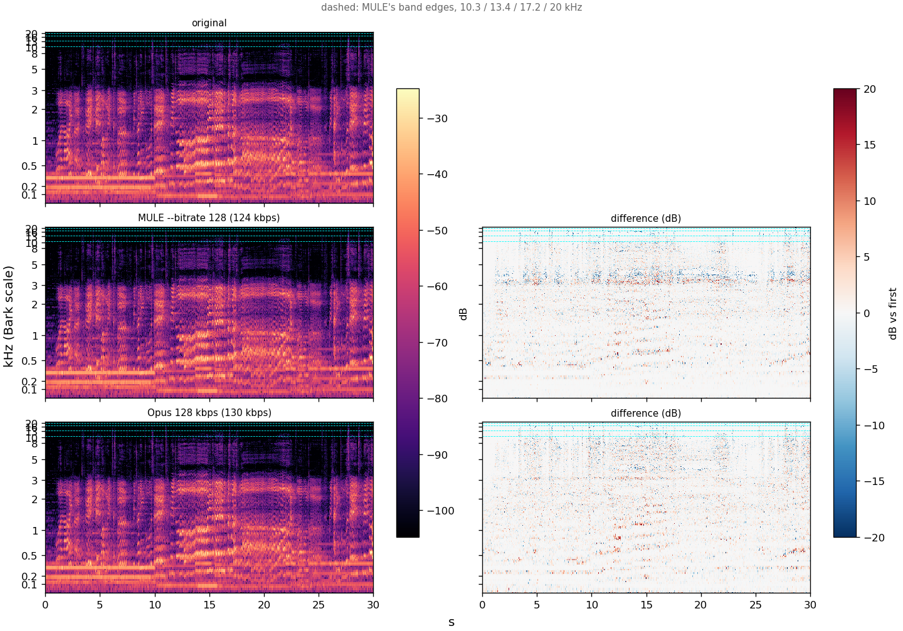
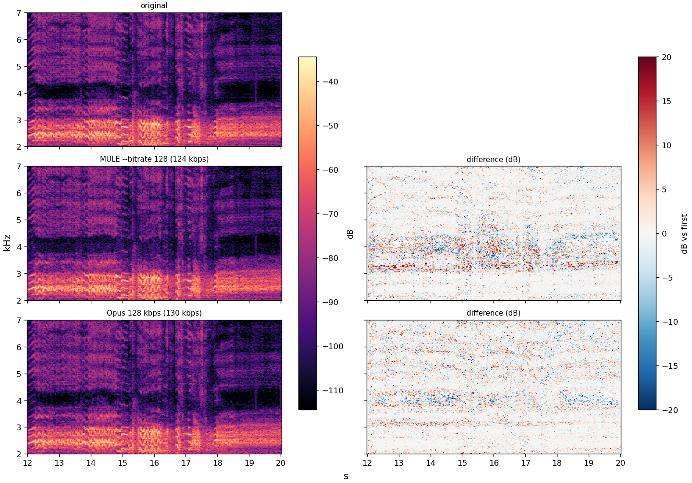

# EBU SQAM samples through MULE at `--bitrate 128`

Listen to MULE without building anything: 16 tracks of the EBU SQAM disc, encoded with the
current encoder and decoded by the reference decoder.

- `decoded/`: 16-bit / 44.1 kHz stereo FLAC, lossless copies of the WAV output of `mule-dec`,
  sample-aligned with the originals (same length, no delay to compensate).
- `mule/`: the encoded MULE files (Ogg container), to check the rates or decode them yourself.

Encoder: `mule-enc --bitrate 128 original.flac out.mule` (26/11/2026, format v5).
Decoder: `mule-dec in.mule out.wav`.

The originals are the tracks of the same number on the EBU SQAM disc (Sound Quality Assessment
Material, EBU Tech 3253), available from the EBU. They are not included: compare against your own
copy.

## About the bitrate

`--bitrate` works like opusenc's: VBR, with a slow rate leveler that pulls each track toward the
requested rate. Its quality-to-rate curve was calibrated on a music library. These SQAM items are
sparse (solo instruments, speech), so the encoder spends less than requested: **99 kb/s on
average** over the 16 files (file size, container and headers included).

| file | duration | rate |
|---|---|---|
| sqam05_pitch_pipe | 28 s | 24.0 kb/s |
| sqam08_violin | 71 s | 112.3 kb/s |
| sqam21_trumpet | 36 s | 89.6 kb/s |
| sqam27_castanets | 20 s | 100.0 kb/s |
| sqam32_triangles | 74 s | 97.8 kb/s |
| sqam35_glockenspiel | 59 s | 83.5 kb/s |
| sqam40_harpsichord | 53 s | 104.1 kb/s |
| sqam48_vocal_quartet | 28 s | 106.4 kb/s |
| sqam49_speech_female_english | 23 s | 95.7 kb/s |
| sqam50_speech_male_english | 22 s | 96.3 kb/s |
| sqam57_organ_bach | 20 s | 89.8 kb/s |
| sqam58_guitar_sor | 16 s | 99.7 kb/s |
| sqam60_piano_schubert | 92 s | 104.7 kb/s |
| sqam65_orchestra_strauss | 112 s | 113.9 kb/s |
| sqam69_abba | 33 s | 111.6 kb/s |
| sqam70_eddie_rabbitt | 21 s | 95.5 kb/s |

## Caveats

All the tuning was done with objective measures (Zimtohrli first, then PEAQ and a noise-to-mask
ratio) on music, not on SQAM; my own ABX tests at 128 kb/s could not tell MULE from the original.
Critical listening reports, good or bad, are exactly what I am looking for.

## What to listen for

MULE codes the spectrum in 22 bands. Inside a band it spends bits on the strongest lines, and a
band coded with few bits, or none, gets noise at the band's level. Above 2.8 kHz (band 12 and up),
the coefficients quantized to zero also get a little noise. The typical artefact is therefore
**noise where the original has a gap**: between harmonics, or in a notch just above a steep
spectral edge, when the gap shares a band with something loud.

The figures below show it on a commercial recording, so it is not in this pack: Purcell's *Ode for
Queen Mary's Birthday*, Z 332 (Martin Neary, *Music for Queen Mary*, 1994). They show a 30-second
excerpt from the middle of the track, as in the 300-track campaign, at `--bitrate 128` (124 kb/s)
and in Opus 128 kb/s (130 kb/s). The left column holds the spectrograms; the right column shows
each codec's difference to the original in dB (red: energy added, blue: energy missing).

The recording falls off by about 30 dB at 3.3 kHz and has a notch from 3.8 to 4.4 kHz. MULE's
band 12 (2.76 to 3.45 kHz) holds the top of the voices and the edge: its quantization noise
spreads a few dB up to the edge (the red line). Band 13 (3.45 to 4.13 kHz) holds the notch: MULE
partly fills it with noise (red) and loses weak harmonics (blue). Opus shows the same pattern,
more lightly; its bands are almost the same there.

Here these differences sit 50 to 60 dB under the voices at 2 to 3 kHz and are probably masked.
In the SQAM items, the places to try are those with clean harmonic spectra and silence between
the lines: the pitch pipe, the glockenspiel, the triangles, the harpsichord, the violin. The
question is whether the space between the harmonics, or the air above them, sounds noisier or
rougher than in the original. The figures come from `eval/spectro_compare.py --scale bark --diff`.
